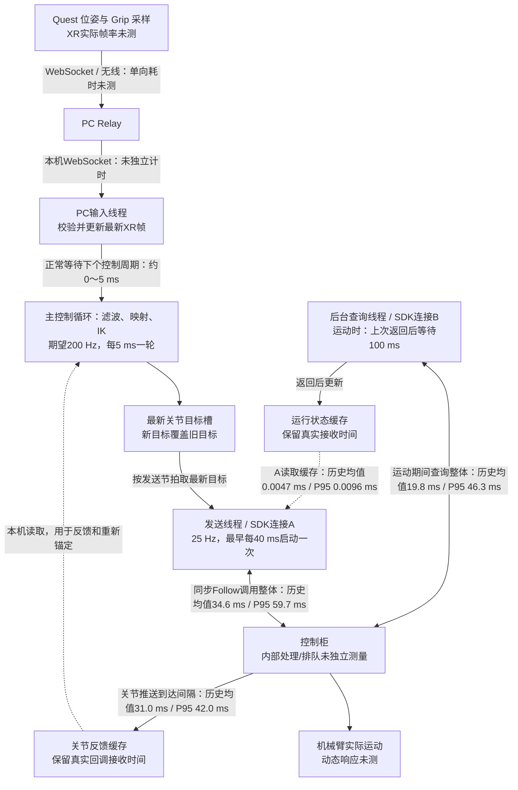

# 当前通信链路与耗时图

核对日期：2026-10-29。当前现场配置：六轴 Follow、25 Hz、waypoint push、parallel state query、world；IK循环期望200 Hz。仅核对代码和只读状态、统计既有诊断，不修改控制代码或阈值。

时间必须区分：实际处理耗时、等待下一周期、数据接收间隔、接收后年龄、保护超时。下列历史分布来自2026-10-28完整120秒并行测试（请求50 Hz），不能作为今天25 Hz测试的完整统计；当前25 Hz未开启完整逐点诊断。P95意为约95%的样本不超过该数。

## 各环节数据

| 环节 | 当前可给出的时间 | 口径与局限 |
| --- | --- | --- |
| Quest内部采样及XR生成 | 未测；跟随XR回调 | 不能将200 Hz IK当作Quest采样率。若实际72/90 Hz，则帧周期13.9/11.1 ms，仅为示例 |
| Quest→PC Relay | 单向延时未测 | performance.now与PC时钟未同步；相对最佳时差能识别积压，不能给绝对单向值 |
| Relay→本机接收、校验与发布 | 未独立计时 | 本机WebSocket，不调用SDK或IK，但仍可能调度延迟 |
| 输入到下一次主循环处理 | 无阻塞且节拍正常时约0～5 ms等待 | 5 ms是轮询周期，不是IK算力耗时，也非硬实时上限 |
| 滤波/映射/IK/runtime.step | 未测纯IK平均耗时；历史120秒runtime.step最大1.62 ms，本轮快照最大17.09 ms | runtime.step包含控制状态处理和IK；滤波与步长约束还会影响跟随相位，不能只看CPU时间 |
| 发送调度 | 配置40 ms启动间隔；若SDK/调度超过40 ms，则进一步延长 | 只取最新目标；不补发。理想近似间隔max(40 ms,本次SDK耗时)+调度开销 |
| 最新候选生成→SDK开始 | 历史均值2.35 ms，P95 4.23 ms | 针对最终被挑中的新候选；不包含某次手部变化等待下个发送机会的全部时间 |
| Follow同步SDK调用 | 历史均值34.61 ms，P95 59.72 ms，最大140.54 ms | 包括库内处理、网络请求/响应、柜端回应等；不能拆成纯网络，也不等于机械臂已运动/到位 |
| 控制柜→实体运动 | 未测 | 接口返回成功不证明开始执行或已经到位；柜内覆盖/排队和机械响应未量化 |
| 运行状态查询B | 运动期间历史均值19.85 ms、P95 46.28 ms、最大136.69 ms | 独立线程与连接；正常发送不等待B查询结束，但过期会撤销运动 |
| 状态查询调度 | 运动：返回后等待100 ms；空闲/停止：返回后等待50 ms | 非固定10/20 Hz；历史运动均值估算约100+19.85=119.85 ms/次，约8.3 Hz；仅由均值推算 |
| 状态缓存snapshot | 历史均值0.00466 ms，P95 0.00958 ms | 纯本机缓存读取，不是网络查询；小耗时不意味着状态刚从柜端产生 |
| 关节推送 | 历史连续回调间隔均值30.96 ms，P95 41.96 ms，最大261.03 ms | 约32.3 Hz；是到达节拍，无法从接收时间推断柜端采样年龄/网络单向耗时 |

历史发送时关节接收年龄均值11.81 ms/P95 40.86 ms；运行状态接收年龄均值58.64 ms/P95 110.42 ms。它们是数据在主机接收后的年龄，不包括柜端采样至主机接收的未知时间。

## 调度与串行关系

输入、IK、A发送、B查询和关节推送并行。A内部仍串行发送运动和停止；同步Follow返回前，A不能再发下一条或发慢停。B正常查询不占用A的互斥锁，历史569次Follow与B查询在途时间重叠。柜端和SDK内部是否仍存在共享资源，不能由两个线程推断。

25 Hz下，若Follow耗时30 ms，理想下次开始间隔约40 ms；若耗时60 ms，则至少约60 ms而非100 ms，因为40 ms是上次开始后的节拍，不是返回后再额外等待40 ms。发生超时或保护停止时不适用这条正常运行近似。

历史50 Hz请求：旧串行实测22.04 Hz，双连接实测25.47 Hz；间隔均值45.38→39.26 ms，P95 99.99→60.05 ms。Follow调用均值33.86→34.61 ms，未缩短；说明查询不再作为必经等待，但同步Follow仍限制节拍。两轮轨迹不同，不是严格同条件基准。今天25 Hz的总体实际频率尚无完整统计。

## 停止链路

Grip释放/输入超时→撤销许可并丢弃旧目标→等待在途A调用返回→慢停→获取新状态与关节→确认静止。

历史完整测试：停止触发→慢停开始均值19.55 ms/P95 45.34 ms；慢停调用均值1023.87 ms/P95 1310.03 ms；停止触发→软件确认均值1338.71 ms/P95 1629.27 ms。这些来自不同运动条件，不能作为当前每次停止固定值。今天异常中断的慢停调用604.72 ms，触发到确认1010.21 ms。

输入有效期200 ms、反馈有效期200 ms、SDK预算500 ms、慢停2秒/反馈确认2秒是保护阈值，不是上述正常时延。今天抓到的是输入更新空档207.97 ms导致核心暂停，当时反馈及B查询正常；它不同于持续运行时同步Follow导致的几十毫秒手感延迟。

## 端到端测量缺口

手部实际动作→机械臂实际开始响应的完整时延尚未测得。应包括Quest采样、无线/Relay、本机控制处理、下一次发送机会、柜端执行和机械动态。SDK调用返回是旁观可测的完成事件，机械臂可能在返回前或返回后开始响应，不能把SDK耗时一律串加为动作开始延时。

历史仅能量化“被选中的候选生成→SDK返回”：均值36.96 ms、P95 61.99 ms，仍不是手到机械臂的总延时。

## 证据

- 当前异常快照：`/data/VR_teleoperation_runtime/aubo-held-grip-status-20261029-094346.json`。
- 历史完整原始诊断：`/data/VR_teleoperation_runtime/follow50-time-race-20261028-205259.jsonl`，1424次发送、1520次状态查询、23个接合段。
- 历史主要统计：`/data/VR_teleoperation_runtime/aubo-parallel-success-summary-20261028.json`。
- 本次补算：`/data/VR_teleoperation_runtime/aubo-chain-timing-supplement-20261029.json`，3895个连续关节回调间隔，1424次候选/发送时间配对。
- 当前代码：`teleop/aubo/quest_preview.py`、`quest_follow.py`、`follow.py`、`state_query.py`、`native/follow.cpp`；Quest前端与核心：`third_party/vr-teleop-kit/src/vr_teleop_kit/relay/web/client.js`、`core/quest_teleop.py`。
