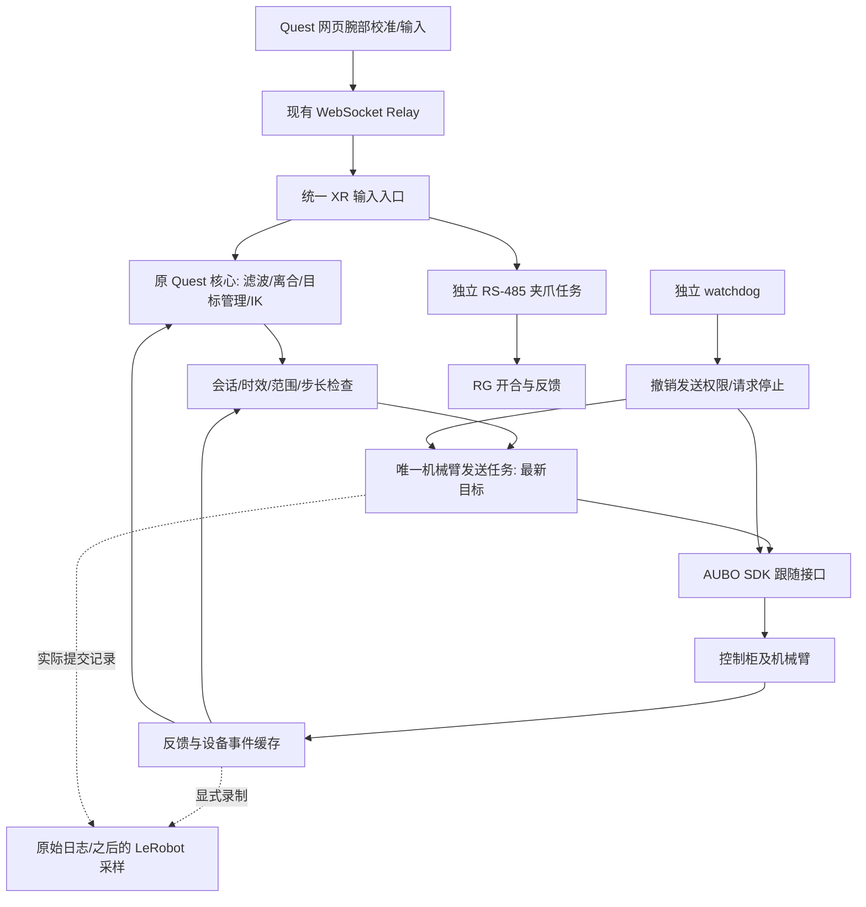

# AUBO i5 真机遥操部署实施方案

更新：2026-10-13。面向操作者与开发者的阅读版。

2026-10-19 后续代码进展见 [J6 受限跟随入口](aubo_quest_follow.md)：Quest 只读预览的输入接合、候选变化、显示和释放已验收；J6 连续序列先前已单独实测。当前已完成 J6 专用 Quest 跟随后端及离线检查，但这个新入口的实体运动、Grip 实体停止和恢复仍未现场验收。本文以下保留各阶段原计划，当前状态以新记录为准。

2026-10-19 接机进展：已完成[只读入口修复](aubo_readonly_fix_2026-10-19.md)及
[裸法兰数学对照、有限反馈检查与跟随测试审查](aubo_flange_and_follow_review_2026-10-19.md)。
目前实际末端为裸法兰，暂不接 RG；下文 RG 部分保留为后续计划。真实跟随和停止仍未验收，
阶段一协调仍为假后端；当前状态优先以上述新记录为准。

同日后续在用户现场监督下完成[单次 J6 微动与慢停](aubo_j6_micro_trial_2026-10-19.md)。
该实验提供真实运动和停止证据，尚未完成连续后端或并发停止。原阶段安排保留作计划，不代表每项已实现。

这是后续实施方案，不是已完成接口的清单。本次编写没有连接机器人、打开夹爪串口或修改控制算法。当前实现状态以 [完整链路再次审查](aubo_chain_reaudit_2026-10-13.md) 为准。

## 1. 要实现的效果与难度

保留已验收的 Quest 遥操算法，将六关节位置输出交给 AUBO 控制柜执行，再把实际关节反馈送回同一核心。初期使用跟随接口作为第一候选，不经旧 `/move_joints` 点到点服务发送每帧目标。

| 工作 | 相对难度 | 原因与完成依据 |
| --- | --- | --- |
| XR 输入接线、命令格式、正式入口 | 较低至中等 | 原有核心和网络协议可复用；需要统一输入入口与故障状态 |
| SDK 跟随接口绑定 | 较低至中等 | 六关节位置函数已有声明；困难主要在运行调度和控制柜行为 |
| 持续反馈与 SDK 回调生命周期 | 中等 | 要处理断连、数据校验、注册/取消、回调仍在执行时退出 |
| 发送调度、独立 watchdog、停止 | 较高，优先级最高 | SDK 可能等待响应；必须确认停止不被发送锁堵住、已接受目标如何处理 |
| 模型/实机一致性核对 | 中等，必须接机 | 六关节顺序、方向、零位、基座和工具定义均影响动作对应 |
| RS-485 二态夹爪 | 中等 | 协议已运行成功，可复用；需明确成功部署配置和退出扭矩行为 |
| 相机与 LeRobot 采集 | 中等 | 要复用唯一控制循环，并保留命令/反馈/图像各自时间来源 |

因此不是从零研究一个新算法，也不是加一行 SDK 调用即可结束。主要工作是一个最小硬件后端及其运行管理。实现复杂度可控；控制柜兼容和停止效果不能靠离线代码保证。

## 2. 固定的共识

- 正式使用 `world + RG`，右手柄；头显 yaw 不参与方向映射。
- 保留作者的位姿滤波、离合、目标管理和解耦 IK 数学求解。不开启旧仿真加速度整形，不自行增加阻抗、力矩或另一套 IK。
- 机械臂上位机发送六关节绝对位置，单位 rad。这不要求增加速度命令接口；限速检查与“发送速度控制命令”是不同概念。
- 新接合以有效实际关节反馈做 FK 建锚；故障停止后必须松开 Grip，取得有效反馈，再按 Grip 恢复。
- Grip 释放撤销后续手柄运动目标；Trigger 可独立切换开/合，保持现有按下沿切换行为。
- 保留仿真 RG_READY、工具和相机模型。首次真机不自动归位；从当前实测姿态初始化。
- Logger 默认 OFF。构建、临时测试与录制数据放在 `/data/VR_teleoperation_runtime` 或另一个用户指定的 `/data` 独立目录。
- ROS 不作为运动链前置依赖；LeRobot 在机械臂/夹爪验收后接入。

## 3. 目标链路与职责



图中的停止到 SDK 的连接是待实现并验证的通道，不表示已经具备可靠物理停止。

将实现集中在现有 AUBO 绑定、硬件 follower 和一个运行入口，复用现有模型/缓存/核心。OfflinePositionSession 继续用作假设备演练依据，不能直接解除其 fake-only 限制后当真机运行时使用。不建立通用机器人插件框架，也不把每个功能拆成独立适配器。

### 输入和故障的归属

网络收到 XR 帧先经过唯一入口，再送入作者核心。设备级故障/恢复状态由一个地方管理；核心负责正常离合和目标生成。故障时调用现有 reset_input 撤销核心接合，避免两套故障恢复机制各自放行。

当前核心 WS 接收器直接调用 core.accept_xr_frame，尚未经过 shadow 的严格入口。实施时须明确这一处路由，并让网络线程只交付输入，避免与控制任务并发修改 session。仿真入口保持现有行为。

### 计算和发送的关系

初期采用一个共同的控制/发送节拍，具体周期依据厂家支持范围和接机结果确定。每个节拍最多产生一个新位置目标，不计算多步再集中补发；不重叠提交运动调用。

电脑只保留最新候选，不建立历史动作队列。候选带输入时效、生成时间和会话编号；提交前再次核对反馈/设备状态/会话/步长。SDK 成功返回只代表该次调用成功，不表示到位。

如果调用超过预算，独立监测任务撤销发送权限。仍在执行的 SDK 请求可能被控制柜接受，因此本机撤销不能替代控制柜停止。发送阻塞后不继续积累 IK 更新，恢复后不重放旧目标。

### 反馈和停止

先用已有有限只读查询确认设备。持续运行优先评估 SDK 的关节/路点推送与事件回调；是否使用以及支持频率需核实。回调只保存小型原始状态，不在回调内运行 IK 或阻塞 Python 控制逻辑。

反馈记录来源、有效性和主机单调接收时间。控制柜采样时间未知时明确标为未知，关节数值不变不意味着反馈失效。设备错误事件与运动命令返回码分别处理。

停止流程的逻辑顺序为：撤销后续提交权限与候选 → 请求经确认的停止 → 读取返回/事件及实际运动状态 → 保持恢复锁存。不能将“已停止发送”或“stop 返回 0”单独作为物理停止证明。

独立 watchdog 能在控制任务停顿时发现故障，但它仍是上位机软件，不等于控制柜或硬件 watchdog。SDK 同实例并发/独立连接的支持与锁行为必须核实；不预先认定再开一个线程或连接就能解决。网络断开时停止请求可能无法到达，需要确认控制柜通信丢失行为。

## 4. 运行状态约定

以下是拟采用的状态职责，不是当前已经存在的正式 API。

| 状态 | 可以做什么 | 进入下一状态的条件 |
| --- | --- | --- |
| 未连接 | 离线计划、假设备测试 | 用户明确执行连接 |
| 只读连接 | 查询身份/配置/状态，不提交运动 | 完成设备核对并明确进入运动测试 |
| 运动待接合 | 反馈和输入有效，但不跟随手柄 | 已完成接口验收，先见到有效 Grip 释放，再见到按下 |
| 遥操接合 | 生成并提交新关节目标 | 正常释放后回到待接合；异常进入停止/故障 |
| 停止处理中 | 不允许新运动提交 | 根据已确认的设备证据确认停止结果 |
| 故障锁存 | 不发送，不重放；报告故障 | 故障消除、有效反馈、确认停止，然后有效释放/按下 |
| 停止结果未知 | 不允许自动恢复 | 人工核对设备状态与停止结果，再显式重建/复位会话 |

正常 Grip 释放也需要处理控制柜尚未执行完的目标；具体停止调用和再接合条件由跟随验收确定，不能仅清空 Python 目标槽。

启动、连接或进入 XR 会话不自动执行 RG_READY；网页归位暂时屏蔽。后续若开放归位，须单独验收路径和速度，不把作者关节插值当避碰轨迹。

## 5. 分阶段实施与验收

### 阶段 1：现在补齐离线运行准备

交付：统一 XR 接线、最小运行入口、机械臂 follower 生命周期、反馈接入、最新目标提交、独立超时监测与停止协调框架。在现有 SDK 绑定基础上补充必要接口，保持现有只读入口无法运动；运动入口在设备配置和停止依据不完整时不放行。

新增假传输验证应覆盖：正常连续提交、发送阻塞、返回失败、结果未知、输入缺失、反馈失效、参考空间改变、Grip 释放、程序退出，以及停止请求异常。已有 78 项回归继续作为基准。

验收条件：

1. 真实 WS 输入能够驱动同一运行路径的假设备，而不只手工调用方法。
2. 控制任务阻塞时，独立监测仍能及时进入软件故障状态并禁止后续提交。
3. 撤销前已在途请求的结果被单独记录；不把撤销描述为请求已取消。
4. 故障后旧候选不能提交，保持 Grip 不自动恢复；只有有效释放/按下才能重新接合。
5. 退出不遗留本地工作线程；回调取消/对象销毁边界有明确处理。
6. 没有设备配置也能完成离线测试；没有自动运动、开爪或清错。

可以离线验证调度和失败处理，不能离线证明物理停止有效。涉及 SDK 并发形式的具体实现须按厂家支持方式收敛。

### 阶段 2：第一次接机只读核对

操作者准备：控制柜型号/示教器版本、实际网络地址/SDK 端口/账户、当前模式和同一末端的安装情况；确认旧业务运动节点不会同时控制机械臂。

运行现有只读入口，核对 SDK 原始返回码、版本/模式、六关节、工具/负载/范围。保存有限报告，不自动 startup、清错、修改 TCP 或负载。

将同一组关节下的 SDK FK 与模型 FK 对照，先确认法兰基准，再确认工具变换。关节顺序、正方向和零位应结合示教器及之后明确授权的小动作核对；静态单姿态只能作为初步证据。持续反馈接入后，记录接收间隔、断连和退出表现。

验收条件：查询可靠、字段含义明确、模型映射有足够证据、工具/负载不再混用旧采摘控制点。异常只报告，不擅自写入修正配置。

### 阶段 3：脱离 Quest 验证跟随与停止

先取得当前固件 FollowMode 的停止/退出和并发说明，再在明确的测试空间、范围与参数下验证。单独测试程序沿用同一个 follower，不另写一套机械臂控制实现。

顺序：当前实测位置初始化 → 小范围单轴变化 → 连续平滑位置目标 → 往返及反向 → 正常停止 → 输入停止/发送故障 → 退出与重新进入。人工观察和实际关节反馈同时保留。

记录调用开始/结束、返回码、提交关节、实际反馈/事件；统计正常耗时与波动。检查方向反转能否及时采用新目标、运行越久是否越滞后、停止后是否继续执行旧目标。电脑最新槽不证明控制柜无队列。

验收条件：选定周期受到支持、延迟不持续增长、实际运动平稳、停止与再进入可重复、没有旧目标重放。可接受速度、误差和时延数值按设备/任务依据填写，不在本计划猜测。

若跟随不支持设备，或目标处理/延迟无法满足需求，先记录原因，再评估透传；不自动切换模式掩盖问题。

### 阶段 4：接回 Quest，再接 RG

机械臂先独立通过：Grip 未接合不跟随；接合从当前实际状态建锚；平移方向/world 旋转正确；头显转动不改变映射；释放、追踪丢失、断流、参考空间变化、网络重连都按状态约定处理。

首次不自动归位，也不复制仿真执行器动力学。可选 MuJoCo 画面显示实测状态并明确标注，目标另行区分。作者 rest bias 可能产生小修正，不宣称接合严格零运动。

机械臂验收后复用现有 RS-485 驱动，核对实际设备路径、节点覆盖后的波特率和开合值。独立串行任务在命令变化时执行，避免串口等待堵塞机械臂。

验收条件：Grip 松开时 Trigger 仍可独立切换开合；连接不自动打开夹爪；反馈失败不冒充到位；断流不重放积压开合；退出行为符合已确认的扭矩策略。用户暂缓的驱动内部整改另行处理，不扩大本轮范围。

### 阶段 5：接相机与 LeRobot 采集

先核对真实相机序列号、安装和图像时间来源，再接入现有 Relay 视频接口。透视操作可先验收机械臂，不要求相机先完成。

LeRobot 使用薄接口访问同一已验收 core/follower。保持唯一控制循环；采集按数据帧率读取状态和已提交动作，不再独立调用 get_action 推进第二次 IK。

原始记录分开保存：XR 输入、生成候选、实际提交目标、SDK 结果、实际关节反馈、夹爪命令/反馈、图像及各自时间。未发送的候选不当作已执行 action。SDK 请求返回时间不标成控制柜执行时间。

验收条件：一小段录制可以回放/检查来源和时间差；断流/故障片段可识别；数据格式符合选定 LeRobot 版本。Logger 和图像落盘仍显式开启，存储在 `/data`；最终训练 action 表达另行决定。

## 6. 需要向厂家/集成商确认的问题

可直接作为询问提纲，不需要懂 SDK 内部实现才能提问：

1. 当前控制柜型号/固件与 Linux SDK 2.5.0 是否匹配？FollowModeJointMove 使用前需要哪些模式、控制权和启动条件？
2. 运动中更新目标是覆盖、排队还是拒绝？允许/推荐的提交周期是多少？位置 profile 的速度/加速度限制是否对跟随生效？
3. FollowMode 的正确停止、退出、再进入接口是什么？停止时是否清除已接受的目标？如何确认已经停止？
4. 发送等待响应时能否在另一个线程调用停止？同一实例/同一连接是否支持？若需要独立连接，其控制权与支持方式是什么？
5. 停止提交、电脑进程退出、网络断开分别会怎样处理当前目标？控制柜是否有通信 watchdog，如何配置和确认？
6. 关节/路点推送的频率和时间语义是什么？有没有采样时间/序号？回调取消和退出是否保证不再调用？
7. GetJointAngleInfo、SDK FK、当前路点分别采用什么关节/法兰/TCP 基准？关节 6 的多圈/360° 配置如何表达？

现有 SDK 对 stop 路径存在静态疑点，详细材料见下面的停止核查。该疑点应请厂家核对，不能当作已经在真机复现的故障，也不能仅换一个 stop 函数名就认为完成。

## 7. 参数与记录怎样固定

接机后建立一份有来源的设备配置：控制柜/固件、SDK 库路径与哈希、关节映射、范围、工具/负载、允许周期、速度/误差/输入与反馈超时、停止方法及支持并发方式、夹爪配置和退出策略。

每项标注“厂家说明”“示教器读取”“实际测试”或“项目约束”。缺项拒绝对应运动阶段，不把测试人工值作为真机默认值。发送周期改变时重新核对滤波时间响应和 IK 单步上限，不简单照搬作者 200 Hz。

诊断报告保持有限大小；持续动作和图像记录只有显式开启时才落盘。SDK 内部异常等待设置不是正常延迟，也不是遥操输入超时参数。

## 8. 当前可运行的命令与未来入口

以下命令当前存在，可在未接机时使用：

```bash
cd /home/lcw/VR_teleoperation
bash scripts/aubo_offline_check.sh
bash scripts/aubo_readonly_probe.sh
```

第一条离线回归，第二条只打印计划。接机后的只读模板如下，三个占位项须替换成已确认值；本次没有执行：

```bash
bash scripts/aubo_readonly_probe.sh --connect \
  --host '<实际控制柜地址>' \
  --port '<实际SDK端口>' \
  --user '<SDK账户>'
```

连续跟随测试和 Quest 真机启动命令尚不存在；实施后再提供完整可运行指令，不把拟定入口当已交付。

## 9. 阅读参考与来源

- [当前链路实际完成状态](aubo_chain_reaudit_2026-10-13.md)、[只读接口使用与边界](aubo_offline_preparation.md)、[仿真基线](simulation_baseline.md)。
- [作者文章](https://aurelarnold.xyz/blog/vr-teleoperation-stack/)。已阅读用户提供的正文；实现细节以固定版本源码核对。
- [作者真机循环](https://github.com/Dream-Machines-Robotics/vr-teleop-kit/blob/8d37f3d6bd44c8ce646f7bc110ac98e802e0ab57/examples/teleop_bi_dk1.py#L169)：get_action → follower.send_action。参考职责划分，不照搬 DK1 频率、自动归位与退出电机行为。
- [DK1 最新目标替换](https://github.com/robot-learning-co/trlc-dk1/blob/12f5368aefd0381461f2c7ffbb5611b4e8c90de9/trlc_dk1_control/robot.py#L116)。它证明该驱动的主机缓存行为，不证明 AUBO 控制柜行为；作者视频的确切外部驱动版本未知。
- [AUBO 厂家头文件：跟随接口](/data/robot_SDK/新版SDK/aubo_sdk-2.5.0-linux64.bf7070c/include/aubo_sdk/serviceinterface.h:415)、[停止接口声明](/data/robot_SDK/新版SDK/aubo_sdk-2.5.0-linux64.bf7070c/include/aubo_sdk/serviceinterface.h:540)。声明存在不表示已验证具体固件行为。
- [跟随客户端行为静态核查](/data/robot_SDK/analysis/aubo_follow_nonblocking_review_2026-10-13.md)、[停止与调用时间边界核查](/data/robot_SDK/analysis/aubo_follow_timing_stop_review_2026-10-13.md)。没有真机耗时或物理停止测试。
- [既有 RS-485 驱动](/data/robot_ws_dev/src/gripper_driver_v2/gripper_driver_v2/gripper_485_driver.py)。用户确认部署成功；其 disconnect 禁用扭矩，不能未经确认作为新采集链退出动作。

早期 /data/robot_SDK/analysis 方案保留了当时“绑定尚未构建”等历史状态；本文件已结合最新实现更新，不将历史状态当作现在的完成清单。
