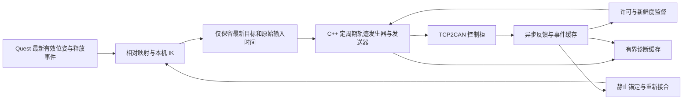

本次结论：TCP2CAN 值得作为降低机械跟随滞后的候选后端，但当前证据不支持“替换一个 SDK 函数即可稳定 200 Hz、零延迟”。应先补齐首帧一致性和最终发送轨迹约束，再隔离同步查询、验证透传调用及缓冲语义，最后与已启用 QUICKACK 的 Follow 做机械响应对照。

核对日期：2026-11-08。只读取当前源码、本地 SDK 资料及已有日志，新增本报告和离线统计；未连接机器人、未切换模式、未发送运动或停止命令、未修改运行代码。工作区存在既有未提交改动，本次未覆盖。

**1. 当前项目已经具备什么。**

上层继续使用 vr-teleop-kit 的相对位姿映射与 DecoupledIKSolver，期望控制周期 5 ms。它是本机运动学计算，不在遥操循环里调用 SDK RobotIk。已有手柄位姿 EMA，默认 pose_filter_alpha=0.8，及 IK 每步关节增量/速度限制。

下层是 Python 调度 + 自建 pybind11 C++ SDK 绑定。native 的发送、查询等阻塞区间释放 GIL；不能套用“旧版 libpyauboi5 封装导致 GIL 堵塞”的诊断。SDK、原生 I/O 锁、主机调度和网络仍可能阻塞。

已有 `command_mode=passthrough`，实际调用 Enter / SetRobotPosData2Canbus / Leave，期望发送 200 Hz。现场 `scripts/aubo_home_field.sh` 则显式使用六轴 Follow25、串行状态查询、waypoint 推送、USB 输入。脚本的 ACK 模式需要显式传入，不能仅凭新代码已存在就认为某次会话启用了 QUICKACK。通用 quest_follow CLI 在未显式选择时可能默认 passthrough，现场入口与通用 CLI 的默认值不同。

**2. 必须优先采用较新的实测证据。**

2026-11-02 Follow A1 / QUICKACK B / A2 回退对照，请求均为 25 Hz：

| 指标 | A1 基线 | B QUICKACK | A2 回退 |
| --- | ---: | ---: | ---: |
| 段内实际发送频率 | 19.059 Hz | 24.238 Hz | 19.136 Hz |
| SDK 调用平均 | 27.138 ms | 13.366 ms | 26.703 ms |
| SDK 调用 P95 | 56.158 ms | 26.554 ms | 56.029 ms |
| 40–60 ms 线侧应答比例 | 47.86% | 0.85% | 47.03% |

这支持客户端 QUICKACK 对既有慢峰有实际作用；不能继续把所有 40 ms 现象归为不可改变的控制柜固定周期。B 仍有 225.160 ms 单次长尾。上述 SDK 往返不是手到机械臂的完整延迟。

后续 QUICKACK + NODELAY 对照实际频率 24.184 Hz、SDK P95 26.745 ms，未显示明确额外收益；人工动作与会话条件不同，也不能据此证明 NODELAY 导致退化。TCP_NODELAY 改的是本端小包发送，TCP_QUICKACK 影响本端对收到数据的 ACK；不能把二者混为一项。直连或交换机拓扑本身不能诊断或消除这类问题。

原始汇总：Follow ABA（本机存档路径：`/data/VR_teleoperation_runtime/tcp-ack-validation-20261102/follow-aba-comparison.json`）；可读记录：[ACK 实施与对照](aubo_tcp_ack_execution_2026-11-02.md)。

**3. 历史 TCP2CAN 也没有达到 200 Hz。**

本次重新逐行读取 `/data/VR_teleoperation_runtime/aubo-passthrough-200hz-20261028-152650.jsonl`，按 nearest-rank 重算分位数：

| 项目 | 结果 |
| --- | ---: |
| SDK 调用 / 有发送的接合段 | 40 / 13 |
| 单次调用最小 / 平均 / P95 / 最大 | 6.418 / 77.876 / 175.423 / 222.686 ms |
| 同接合段发送起点间隔数 | 27 |
| 间隔平均 / P95 / 最大 | 96.374 / 232.128 / 253.554 ms |
| 段内间隔合并的实际发送频率 | 10.376 Hz |
| SDK 返回码 | 40 次均为 0 |

这是旧的、短接合且含控制循环累计落后误停的会话，早于后续循环修正和 QUICKACK 验证。它不能用于宣称 TCP2CAN 最快只有 10 Hz，也不能与 11-02 Follow 表格直接比较优劣。它足以否定“透传函数在本机一定只耗时 1–2 ms”或“设置 5 ms 就已经稳定 200 Hz”。本轮所有调用最小值也超过 5 ms。

首帧另有明确缺口：13 个接合段中，10 个首帧目标相对发送前缓存实测值的最大轴差超过 0.01 rad，最大 0.043398 rad（约 2.487°）。第一段 J5 差值约 0.031250 rad（1.790°），缓存反馈接收年龄约 64.03 ms。这是目标与缓存反馈的比较，不能当作驱动器同一采样时刻的真实误差，也不证明该误差就是当时中断或抖动的原因。

离线重算结果与输入 SHA256 保存在 `/data/VR_teleoperation_runtime/tcp2can-review-20261108/historical-passthrough-summary.json`。

**4. 用户提供分析中，哪些成立、哪些需要修正。**

| 原判断 | 针对本项目的结论 |
| --- | --- |
| 首帧与实际关节对齐 | 应显式实现，并涵盖每次重新接合；仅初始化变量不足 |
| 0.01 rad 是官方首点硬阈值 | 本地已核对的接口文档和学习资料没有找到这项明确保证，不能当作通用安全阈值 |
| 纯透传完全没有缓冲/处理 | 不能由接口名称推断；公开官方 ROS1 驱动存在轨迹整形、批量发送和缓冲管理，需针对本机固件确认 |
| 没有柜端常规轨迹规划，所以零延迟 | 不成立；同步通信、缓存、采样、伺服及机械动态仍有延迟 |
| 官方要求严格 200 Hz | 本地旧学习资料展示调用后 sleep 5 ms；没有证明本机固件对执行周期、抖动和断流的完整要求 |
| 200 Hz 发送循环应避免同步状态查询 | 正确；本地缓存读取仍可且需要保留，运行状态观测也不能直接删除 |
| 所有 Get 都耗时 30–40 ms | 不能按名字判断；有些 getter 只读 SDK 本地内存，网络请求的耗时也有分布 |
| 另开线程查询就不会影响发送 | 同一 SDK 实例仍可能共享锁；独立连接也需验证柜端共享资源和 SDK 并发规则 |
| Python/GIL 是当前核心瓶颈 | 本项目没有使用上述旧 Python SDK，且 native 阻塞调用释放 GIL，现有证据不支持此归因 |
| 一阶低通即可保证透传运动平滑 | 能抑制部分高频跳变，但不能保证速度/加速度/jerk、首帧连续性或关节范围 |

本地 SDK 明确提供关节绝对角度 rad 的单点与 vector 批量重载。学习资料示例先 JointMove 到 wp1，再进入透传，循环每次增加 0.0001 rad、发送、sleep 5 ms；它是历史使用示例，不是实时性和停止保证。其 1000 次递增总运动 0.1 rad，约 5.73°，并非静止纯性能测试。

**5. 当前实现需要改进的具体位置。**

1. `teleop/aubo/follow.py:751` 进入透传后，仅把 `_last_sent_q` 赋为 q；下一次发送仍由 `target = projected` 取最新 IK 目标。`native/follow.cpp:333` 的 `last_target_=measured_` 也只是本地赋值，没有发送保持点。缺少“首个实际调用必发 q_hold”的保证，模式进入期间上层 IK 还可能继续前进。
2. `follow.py:786` 普通六轴遥操直接转发 projected；`native/follow.cpp:379` 主要校验新鲜度、范围、许可和间隔，未独立约束连续发送的速度、加速度、jerk。上层 IK 每 5 ms 的增量限制，无法保证若干 IK 周期后被抽取的目标仍满足驱动器实际消费时基下的轨迹约束。
3. `follow.py:688` 的单连接路径仍定期先执行 `_observe()`，再检查发送是否到期。即使关节来自 push，运行状态仍要同步查询。透传目前不允许现有独立状态连接选项，也不能启用现有 `--tcp-ack-mode`。不能把当前 Follow 专用参数直接拼到 passthrough 启动命令上。
4. 现有 `sdk_budget_s=0.5`、`send_max_gap_s=0.65`、`input_max_age_s=1.0` 是旧路径的异常处理策略，不是 200 Hz 正常周期或厂家断流保证。保持 200 Hz 的要求不能只靠最终低于这些预算来验收；也不能未经分析随意修改阈值让程序不再报错。
5. `native/follow.cpp:410` 的停止与发送共用 `io_`，撤销许可不能中断在途 SDK 调用；当前先 Leave 再 slow-stop 的顺序需专门验证对本机 TCP2CAN 的语义。Follow 的停止修复和现场成功记录，不能直接替代透传断流、退出及停止验收。

此外，当前归位/放置及数据集记录等入口有 Follow 专用限制。不能把六轴后端切换理解为这些功能已自动支持 TCP2CAN。

**6. 首帧与控制权交接应如何实现。**

建议使用显式状态流程：`STOPPED → ALIGNING → ENTERING → HOLDING → ACTIVE → STOPPING → STOPPED/FAULT`。

- ALIGNING：以有效、新鲜反馈确认静止，记录 q_hold；撤销旧目标槽，递增 session/generation，丢弃之前的 VR/IK 候选。
- ENTERING：模式切换期间不允许发送器采纳活动 IK 目标。状态/反馈过期、进入失败或期间撤销都进入故障/停止处理，不自动重试进入。
- HOLDING：首个实际 SetRobotPosData2Canbus 参数必须就是 q_hold。静止条件应覆盖反馈读取到首发之间；模式进入耗时过长时，不能继续使用已过期的 q_hold。
- 以同一姿态初始化发送器的 q、dq、ddq；确认原本静止时 dq=ddq=0。完成进入和保持点交接后，才以新的有效手柄位姿与 q_hold 的 FK 建相对控制锚点，允许生成当前 session 候选。
- ACTIVE：最终轨迹发生器从其上次已提交的连续状态向最新有效 IK 目标推进。普通 30 ms 左右关节反馈用于监控和重新接合，不每帧覆盖发送器/IK 的连续状态。

“首帧保持”不等于建议对运动中机械臂直接突发保持命令；本方案要求进入前已确认停稳。是否需要预填点、多少点、何时开始消费，应以对应固件说明为准，不能自行加深队列。

**7. 平滑需要兼顾延迟与运动约束。**

固定 200 Hz 时，一阶滤波 `q[k]=(1-alpha)*q[k-1]+alpha*q_target[k]` 的低频附加群延迟近似为 `T*(1-alpha)/alpha`，阶跃达到 90% 的连续近似时间为 `T*ln(0.1)/ln(1-alpha)`：

| alpha | 低频附加延迟约 | 90% 阶跃响应约 |
| --- | ---: | ---: |
| 0.05 | 95.0 ms | 224.5 ms |
| 0.15 | 28.3 ms | 70.8 ms |
| 0.30 | 11.7 ms | 32.3 ms |

这不是额外固定的纯传输时延，但会表现为跟手变慢。若目标瞬间相差 0.5 rad，alpha=0.15 的第一步仍是 0.075 rad，滤波没有保证首帧或速度约束。程序实际只有 20 Hz 而仍使用同一 alpha 时，时间尺度还会扩大约十倍。

建议先保留现有位姿滤波作为对照，在 IK 与最终发送之间增加有位置、速度、加速度及 jerk 约束的在线轨迹发生器，例如评估 C++ Ruckig 或等价实现；它负责最终发送序列，不能只给每个关节独立 clip 位置就宣称 jerk 有界。关节限位附近要考虑可制动距离，必要时还要受 TCP/工作空间速度约束。

发送器中连续状态的推进必须与控制柜确认的点消费周期一致。若网络阻塞跨过多个周期，不把缺失点丢掉后直接发送远期轨迹点，也不突发补发过时目标；应执行已验证的保持/停止/缓冲故障策略。主机使用“真实 dt”不自动等于驱动器也按该 dt 执行。

若仍保留可选 EMA，宜用物理时间常数与有效 dt 计算 alpha，而不是写死 0.15；异常大 dt 先处理断流，不能用它把 alpha 放大后跳向目标。所有新增滤波/整形均应测量新增相位滞后，避免把控制手感调得更黏。

**8. 建议的软件分工。**

Python 保留 VR、映射和 IK；C++ 承担确定的发送时基、最终轨迹状态与模式生命周期。先完成同步调用能力验证，再决定是否值得迁移调度，C++ 不会消除 SDK 的 40–200 ms 阻塞。

发送热路径仅做缓存读取、局部校验、整形与发送，不做阻塞状态查询、逐帧打印、UI 绘制或写盘。状态观测使用已验证的回调/事件，确有必要的查询由厂家支持并经测量的独立路径承担；waypoint 推送仅有关节/路点，不能自动替代全部运行状态和故障信息。

调度用 monotonic/steady_clock 和绝对期限，不使用 `SDK(); usleep(5000)` 冒充 200 Hz。后者即使 SDK 只耗 1–2 ms，也只有约 167–143 Hz。记录错过的期限，避免紧循环突发追赶。只有用户态调度确认为主要瓶颈后，才评估 CPU affinity、实时优先级或 PREEMPT_RT；它们不能修复网络请求本身的阻塞。

柜端若必须 FIFO，则区分“上位机最新目标槽”和“柜端必要的小缓冲”。不能通过长队列让曲线看起来顺滑；若每点执行周期 T、已有 N 点待执行，队列会引入约 N*T 的等待。单位、容量、最小水位和清空语义未确认前，不使用预留诊断字段控制发送。

**9. 实施与验收顺序。**

| 阶段 | 具体工作 | 进入下一步的依据 |
| --- | --- | --- |
| A：离线改造 | 显式首帧保持、session 交接、最终轨迹约束、原始 XR→发送关联；补充假 SDK 与故障注入验证 | 首帧相等、过期点不发送、限位/运动约束有效、撤销期间不误重入 |
| B：确认协议 | 核实本机完整系统/固件版本、消费周期、FIFO/覆盖规则、缓冲和断流/退出/停止语义 | 有对应版本资料或厂家可验证说明，不以“V4.5”大版本笼统代替 |
| C：受控保持点测量 | 在已确认模式/停止规则下，不接 VR、不算 IK，首帧及后续只发当前停稳角度；按允许周期限时采样 | 量到 TCP2CAN 自身耗时、发送间隔、长尾、缓冲和退出结果；保持点也属于模式/控制测试，需要现场监督 |
| D：隔离通信问题 | 核对 SDK/线侧时序，比较必要推送与查询负载；验证适用于透传连接的 QUICKACK 干预 | 证明优化确实作用于目标 socket，不能用目前 Follow 专用开关假装透传已启用 |
| E：受限动态与遥操 | 小幅平滑单轴，再多轴，再 VR；同一轨迹/约束/负载对比 Follow+QUICKACK 与 TCP2CAN | 相位滞后、误差、反向响应和停止表现同时改善 |
| F：整合功能 | 单独接入归位、放置、记录及夹爪协调，验证完整会话 | 独立验收通过后再考虑正式默认值 |

阶段 C 首先零增量保持当前姿态，避免以 1000 次 `q[5]+=0.0001` 把运动与通信测量混在一起。保持点测试无法完全代表动态柜端处理，后续仍需阶段 E。TCP2CAN 若要求固定消费率，不能随意按 20→50→100 Hz 低频试发；任何阶梯都必须在已确认允许的范围内。

对于 5 ms 目标周期，应至少报告发送起点间隔、SDK 耗时 P50/P95/P99/最大、超过 5 ms 的比例、连续错过期限数量、最长无更新间隔和退出结果。只有平均频率接近 200 Hz 远远不够；若单次同步发送在目标条件下仍反复超过 5 ms，当前单点同步调用就不能逐周期保证 200 Hz，须优先解决通信或采用厂家支持的流式/批量方案。任何批量方案还需量化额外缓冲延迟。

机械效果另看：原始输入接收→目标生成→发送开始/返回、目标/反馈的相位与幅值、反向后的继续运动、Grip 释放后的位移和物理停稳时间。软件确认停止耗时不能当作机械制动时间。现有反馈约 30 ms 一次且没有柜端采样时间戳，无法仅凭它证明 5 ms 的物理响应；必要时用共同时间基准的外部测量或更高频控制器记录。

**10. 需要厂家回答的最少问题。**

1. 本机完整固件版本下 TCP2CAN 的推荐发送周期与点消费周期，允许的抖动、断流时限和欠载/超载行为是什么？
2. 单点与批量接口是最新值覆盖还是 FIFO？各字段的计数单位、深度、状态可读性和退出/停止后的清理规则是什么？
3. 进入时的静止要求、首点限制、预填要求，及现有 SDK 2.5.0 是否是推荐兼容版本？
4. 停止发送、Leave、缓停、急停、断网分别发生什么，正确顺序是什么？原运动参数与保护在该模式下哪些仍有效？
5. 是否有无需同步等回执的官方低延迟流接口、可配请求超时，以及带柜端时间戳的高频反馈？

这些是协议和实现参数的确认项，不代表本次代用户联系厂家。

**证据位置。**

- 当前实现：`teleop/aubo/follow.py`、`native/follow.cpp`、`native/passthrough.hpp`、`quest_follow.py`、`shadow.py`、`scripts/aubo_home_field.sh`。
- 本地资料：`/data/robot_SDK/analysis/tmp/learning.txt` 的 TCP 转 CAN 章节；`linux_api.txt` 的 2.3.47–2.3.49；SDK 2.5.0 `serviceinterface.h:565` 起。文本索引来自现有 PDF，版本差异见 `/data/robot_SDK/analysis/aubo_i5_sdk_review_2026-10-13.md`。
- 官方 ROS1 源码本地快照：`/data/robot_SDK/analysis/references/aubo_follow/official_ros1_aubo_driver.cpp:311` 起和 `:931` 起。用于说明官方驱动存在轨迹/缓冲管理，不能替代本机固件规范。
- Follow 对照原始汇总：`/data/VR_teleoperation_runtime/tcp-ack-validation-20261102/follow-aba-comparison.json` 与 `follow-quickack-combined-comparison.json`。
- 本次透传重算：`/data/VR_teleoperation_runtime/tcp2can-review-20261108/historical-passthrough-summary.json`，包含源日志路径、SHA256、分位数算法及逐接合首帧差值。
