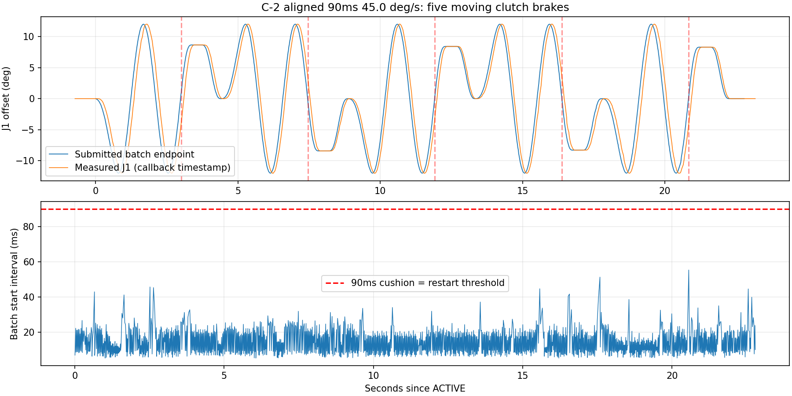
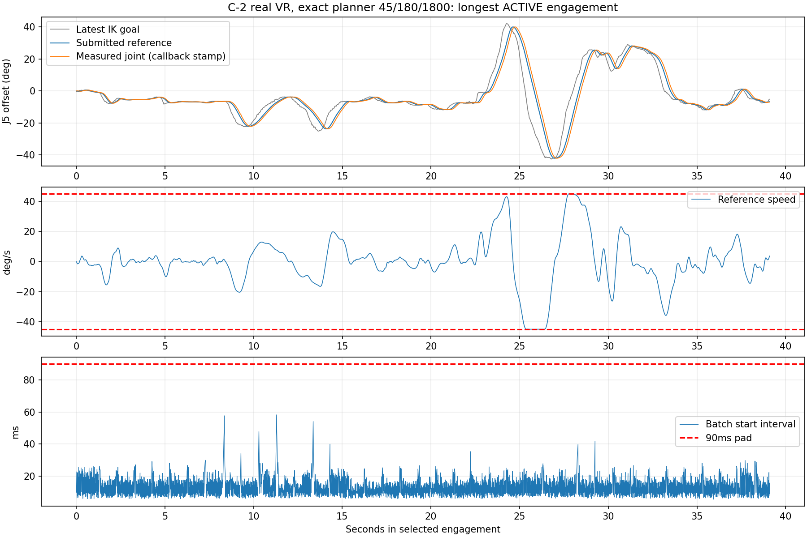

# 真机遥操基线：aubo-c2-refined90-2026-11-12

状态：**操作者已验收并明确同意固定为基线**（2026-11-12，北京时间）。对应车载构建 `c2-aligned90-20261112`。此文是当前真机配置入口；旧 Follow、C-1、25档提速与50ms/90ms失败候选记录保留为历史，不覆盖本基线。仿真基线另见 [sim-world-rg](simulation_baseline.md)。

用户先确认25档“很平滑，没啥问题”，再确认45档咔哒声“已消失，运动和回程均可接受”，真实自由VR后反馈“效果非常好，跟随的不错”，随后授权固定版本。后续改动以此为回退点，分别验证；不因继续优化延迟而直接提高速度、缩短缓冲或放宽静止容差。

## 冻结配置

| 项目 | 基线 |
| --- | --- |
| 设备和接口 | AUBO i5，V4.5.111控制柜，PC SDK 2.5.0 Linux x64，TCP2CAN vector批量路点 |
| VR链路 | Quest 3 USB WebXR，作者world相对映射，HMD yaw对齐关闭 |
| 参考速度/加速度/jerk | **45°/s、180°/s²、1800°/s³**（practical） |
| 规划 | 五次曲线保持q/v/a连续；检查整段真实导数极值及位置范围，含位置极值所需的四次根 |
| 固定采样 | 5ms；批内及跨批Native最大步长 **0.225°+浮点裕量** |
| 供点 | **18点/90ms名义垫；恢复阈值同为18点**；2点触发、单批最多8点 |
| 欠供保护 | 预充完成后净欠供>0立即零速重起步；计划与SDK提交前都检查，不再额外等待单次空窗超阈值 |
| 重起步 | 最后已提交点q_last_sent，v=a=0；先2点、最多4点小批逐步补垫，预充期间不循环误恢复 |
| SDK连接 | A只发点且TCP_NODELAY=1；B独立查状态；C独立关节推送 |
| B查询 | PRIMING/ACTIVE/BRAKING/HOLDING暂停；准入及退出透传后恢复20Hz |
| 热离合 | Grip释放平滑制动至HOLDING；BRAKING或HOLDING重新捏合从当前参考状态即时建锚，无5快帧/100ms静止前置等待 |
| 首次准入 | 冷入模PRIMING固定姿态；至少12步、最近5次调用≤40ms；2.5s预热上限 |
| 硬保护 | C关节年龄≤500ms；B参与监控时状态年龄≤500ms；A单次≤500ms；连续3次A>250ms闭锁 |
| 制动和静止 | 45档动态参考/反馈包络13.5°；最终HOLDING静止准入≤0.1°；保持空闲20s退出热会话 |
| 本轮附加功能 | 未启用录制、物理夹爪、自动归位、放置和相机；本轮验收不覆盖这些功能 |
| 回退档 | conservative=10/30/300；balanced=25/75/600。保留advanced=35/105/900兼容旧名称，不表示比新practical更快 |

5ms和90ms是主机执行设置，未用实时FIFO仪器独立认证控制柜物理消费周期。200Hz是曲线点时间基准，不要求每秒200次RPC；2点/10ms及批量追赶使RPC次数与供点数不同。

## 验收证据

本机643项AUBO回归、车端27项Native专项通过。实际SDK绑定编译和Native生命周期检查通过。离线生产C++绑定+模拟SDK覆盖105ms单空窗、多个65ms慢调用累计欠供、计划到提交间过期、部分预充及恢复补垫；没有在实体高速运动中人为注入断流。

两档均先静止5秒，再完成五次非零速度松手制动与热接合，退出停稳确认成功：

| 指标 | 25/75/600 | 45/180/1800 |
| --- | ---: | ---: |
| 程序目标 | J1±8°，峰速24°/s | J1±12°，峰速43.2°/s |
| 最大批起点间隔 | 57.24ms | 55.32ms |
| 最大步长 / 限制 | 0.119998° / 0.125° | 0.215996° / 0.225° |
| 最大制动方向越界 | 0.00375° | 0.00961° |
| 最大HOLDING准入偏差 | 0.00339° | 0.00751° |
| 欠供重起步 / 硬闭锁 | 0 / 0 | 0 / 0 |



真实自由VR运动窗口约114.17秒：1次冷入模、7次热接合、8次松手保持，8530次发送返回（含预热），参考峰速44.999°/s，最大步长0.224998°。Grip响应中位4.31ms、最大4.81ms；8次HOLDING最大准入偏差0.00695°。无硬闭锁，最后右手柄消失后正常停止并确认停稳。

本轮自由VR有**2次欠供零速恢复**，其中一次由提交前检查拦住未发送批次；不能把它写成“零欠供”。稳态账本已识别净欠供却仍提交的批次为0。参考终点与反馈最佳时间平移约99ms，包含前瞻、通信与反馈，不是头显到电机的绝对延迟；不同动作的旧/新统计也不是严格同轨迹A/B。



静止到静止离线规划时间（含1%时长裕量，5ms最后采样向上取整）：

| 位移 | 旧凸包25档 | 精确25档 | 精确45档 |
| --- | ---: | ---: | ---: |
| 5° | 1.380s | 0.802s | 0.556s |
| 10° | 2.385s | 1.010s | 0.700s |
| 20° | 4.121s | 1.515s | 0.882s |

完整记录：[对齐90ms两档实机验收](aubo_c2_aligned90_2026-11-12.md)、[真实VR分析](aubo_c2_vr_follow_analysis_2026-11-12.md)、[规划改造及失败50ms候选](aubo_c2_exact_extrema_2026-11-12.md)。本基线为已记录设备/配置下的有限人工遥操验收，长时无人值守、全工作空间、无线、故障断网和相机/夹爪/数采联合运行未因此获验收。

## 版本、产物和指纹

Git固定标签：`aubo-c2-refined90-2026-11-12`。在没有未保存改动的独立检出中，可用`git switch --detach aubo-c2-refined90-2026-11-12`恢复该源码/测试/文档快照。标签不包含机器上的SDK、构建产物或运行时清单，也不会启动机械臂。

可机读配置：[baseline.json](baselines/aubo-c2-refined90-2026-11-12/baseline.json)；源码清单：[source.sha256](baselines/aubo-c2-refined90-2026-11-12/source.sha256)。从项目根目录可离线核对：

```bash
sha256sum -c docs/baselines/aubo-c2-refined90-2026-11-12/source.sha256
```

- SDK发布库SHA256：`a04ad0aa05b2d46fea5a863fe30698950e6434afeafd5a3eaf605c3f0df0ff1b`。
- 已验收车端Native SHA256：`f836d7bd0583a5919598e059dcc14c33475fe9d3f6cab04cd89f1e80f69276c7`。不同环境重编译的二进制哈希可能不同，不能仅凭重编译成功继承实机资格。
- 作者仓库固定提交：`8d37f3d6bd44c8ce646f7bc110ac98e802e0ab57`，作者核心与本项目执行层职责见[改动说明](../third_party/vr-teleop-kit/LOCAL_CHANGES.md)。
- 车端根`/home/xc/code/lcw/VR_teleoperation_runtime/follow-build.json`原子指向`c2-aligned90-20261112/build-follow/python/`内绑定；旧manifest备份保留在该候选`default-follow-build-before-promotion.json`。
- 本机SDK在`/data/robot_SDK`，本机原始报告/构建/诊断在`/data/VR_teleoperation_runtime/c2-aligned90-20261112`；车端沿用既有`/home/xc/code/lcw/VR_teleoperation_runtime/c2-aligned90-20261112`。新大文件继续优先落`/data`，不迁移既有SDK或数据。
- 仓库只保存源码、测试、参数摘要与上述小型审阅图；SDK、so、原始JSONL、录制及研究PDF不作为基线源码提交。

## 复现与启动

先在离线环境安装[项目依赖](../environment/README.md)，配置SDK对应的`readonly-build.json`；`scripts/build_aubo_follow.sh`核对SDK哈希并编译真实/模拟绑定。新构建默认不获得已验收部署资格，不能把构建模板的10档或12点占位值当成本基线，也不要将别机的SDK/模块路径原样复制。用上表和源码指纹核对，按Stage A、25档、45档受控程序顺序验证，再记录本机qualification并原子晋升清单。

离线回归（不连接设备，使用已经构建的模拟绑定）：

```bash
AUBO_RUNTIME_DIR=/data/VR_teleoperation_runtime \
  /data/VR_teleoperation_runtime/.venv/bin/python -m unittest discover -s tests -p 'test_aubo_*.py'
node --test tests/test_recording_hud.cjs tests/test_xr_input_gate.cjs
```

车端**已有已验收清单**时的等价人工VR启动命令如下。先退出原会话，启动冲突检查会拒绝重复SDK连接；下列命令登录真实设备并开放人工Grip运动，SDK密码交互输入。

```bash
cd /home/xc/code/lcw/VR_teleoperation
export TELEOP_RUNTIME_ROOT=/home/xc/code/lcw/VR_teleoperation_runtime
export AUBO_ALLOWED_ROOTS=/home/xc/code/lcw/VR_teleoperation_runtime
adb reverse tcp:8443 tcp:8443
bash scripts/aubo_quest_follow.sh \
  --execute-six-axis --command-mode passthrough --waypoint-feedback \
  --refined-stream --motion-profile practical --tcp-ack-mode nodelay \
  --runtime "$TELEOP_RUNTIME_ROOT" \
  --usb --headless --host 192.168.1.5 --port 8899 --user aubo \
  --rotation world --duration 1800 --relay-port 8443
```

网页`http://127.0.0.1:8443/`，先Start Teleop，完全松开右Grip，再捏合。改用`--motion-profile balanced`或`conservative`选择回退档，需退出当前连接再启动，不运行中换档。本轮未启用的录制/夹爪不因历史入口默认选项而自动纳入基线。`scripts/aubo_passthrough.sh`默认可能启用录制和夹爪；复现纯遥操时需明确`--no-record --no-gripper`或使用上述命令。

误按实体急停后先现场释放/复位并恢复允许状态；软件不能代为释放硬件急停。确认机械臂停稳、旧会话退出、停止结果明确，再核对新鲜状态并重建会话。不得自动追赶急停前目标。20:31恢复事件记录在对齐验收文档中；PID及会话结束时间属于当次记录，不是持久服务标识。
