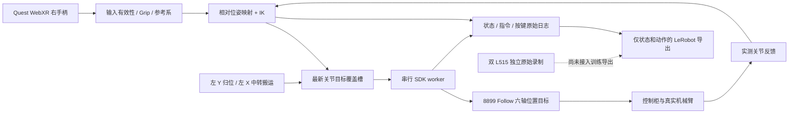
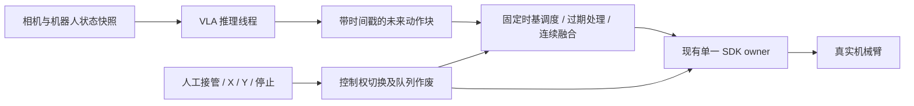

# HarvestFlex 论文与当前 AUBO 遥操 / 数采 / VLA 链路对齐审查

日期：2026-11-02。性质：论文阅读、源码审查、既有现场证据复核及车载只读检查。本轮未启动机器人 SDK 会话，未发送运动命令，未修改控制代码或现场参数。

> 本文是2026-11-02历史审查。后续多模态采集/export/QA已有实装并通过有限真机数据验收，早期“LeRobot无图像、当前工具/相机未就绪”等判断不能用于描述现状。请以[2026-11-15正式数采基线](aubo_collection_baseline_2026-11-15.md)为准。

## 1. 结论与适用范围

**当前项目在“单人 VR 遥操及录制管理”方面已经有可用且与论文思路相近的基础；尚未完成论文所需的“多视角图像—状态—动作数据集—VLA—异步执行”闭环。** 最需要补的不是更多手柄按键，也不是先把某一个频率数字改成论文的数字，而是三个接口：

1. 将相机原始录制接入有明确时间语义的训练样本；目前 LeRobot 导出不含图像。
2. 定义机器人及夹剪工具的状态、动作和时间语义，确定首版模型承担的任务范围；目前只有六轴绝对位置目标，且自动搬运被训练导出排除。
3. 在真实机械臂吞吐、推理耗时及停止约束下建立策略执行器；当前遥操最新目标槽不等于论文的未来动作块队列。

建议保留已经现场验证的 Grip、左 Y、左 X 及停止基础。首版采用“学习接近 / 操作，确定性执行固定篮筐搬运”的分工更适合现阶段。完整夹持、剪切、退出和释放训练，需要真实工具安装、标定和验收后开展。双场景相机可以先验证数据工程，腕部视角应在正式接触操作数据采集前落实。

### 阅读和证据

- 论文原件：`/home/lcw/tomato_robot/docs/papers/00_基准与直接先例/HarvestFlex: Strawberry Harvesting via Vision-Language-Action Policy Adaptation in the wild.pdf`，arXiv:2603.05982v1，2026-03-06，共 8 页。
- 已全文阅读，并渲染核对方法、图 5 手柄、图 6 异步执行及第 6 页结果表。文中页码指 PDF 页码。
- 当前仓库源码，重点为 `quest_follow.py`、`follow.py`、原生 Follow / 透传绑定、`operator_controls.py`、`placement.py`、`recording.py`、`export_lerobot.py`、相机脚本和 relay。
- 车载只读复核：最近会话 `20261102-185123-2a9d962f` 的 manifest；15 个关键源码文件的 SHA256 与本地一致，包括头显 HUD。GPU 为 RTX 2060 / 6144 MiB，物理内存约 8 GB。未据此推断模型推理性能。
- 车载复核记录：`/data/VR_teleoperation_runtime/harvestflex-review-20261102/vehicle-readonly-evidence.json`。
- 现场证据采用 `aubo_placement_field_checkpoint_2026-11-02.md` 的最新结论；ACK 分析采用历史报告顶部修订及对应统计，不使用已失效的实验启动步骤。

下文严格区分：**源码已实现 / 现场已验证 / 文档规划 / 尚未确定**。配置名字、函数存在、回归通过均不能替代真实作业验收。

## 2. 论文实际做了什么

### 2.1 任务闭环，第 2 页 II.A

目标选择 → 接近及避障 → 包络夹持及分离 → 容器上方释放 → 重试或复位。

两个容易被忽略的条件：

- 分离失败时立即重试，**不先归位**；只有果实已分离且被稳固抓持，才进入放置。
- 成功采摘并放置后才复位开始下一轮；一个 episode 可以包含多个采摘—放置循环。

阶段标签来自遥操日志及关键事件，并用时间戳与图像、动作对齐。文章没有证明每个阶段转换都由独立的自动检测器完成，不能据此要求我们先开发一整套自动成功检测系统。

### 2.2 遥操与感知，第 2–4 页 II.B–C、表 I、图 5

- Quest 3 手柄产生连续末端位姿命令；头显获得低延迟多视角画面，同时保存原始图像。
- 两台固定 D455：1280×720、30 fps；一台腕部 D405：640×480、30 fps；训练视觉使用 RGB。
- 按键包含 Pump、Pause、Reset、Deposit、Bend stem，以及 Restart loop / Exit the loop / Exit the record。图 5 可以支持功能对应，不宜根据示意图推断所有物理键的唯一映射。
- 暂停后恢复时通过目标插值避免跳变；底层采用速度模式，另有动作裁剪、工作空间限制和急停约束。
- 文中报告平均端到端遥操延迟小于 0.1 秒；同时写“所有模块高于 50 Hz”，但相机明确 30 fps，部署控制也明确 30 Hz。这些表述不能组成“所有链路必须 50 / 200 Hz”的严格规格。

### 2.3 数据和训练，第 3–4 页 II.D–E

- 3.71 小时、227 个 episode、491 次有效尝试，包含成功和失败，保留失败后的重新定位、滑落重试和放置纠正。
- 有光照、遮挡、目标数量、成熟度的覆盖统计，不只是同一个点位反复成功。
- 输入是三路 RGB、机器人状态和语言目标；动作由连续机械臂命令及离散泵命令构成。
- 文章写连续臂动作 7 维、最终动作 8 维、状态 8 维，但**没有逐维说明名称、单位、坐标系和底层转换**。六自由度机械臂不意味着这 7 维就是七个关节速度，更不能自行认定为 xyz + 四元数。
- 工具是柔性气动末端，泵命令为 `{in, out, idle}`。这与番茄串夹剪工具不等价。
- 对比 π0、π0.5、WALL-OSS，全量微调与 LoRA；训练使用 2×A800 80GB、batch 16、6 epochs。论文给出了 openpi / wall-x 的固定提交版本，但未给出足以逐项复现其机器人适配器的完整说明。

### 2.4 部署，第 4–5 页 II.F、图 6

- 推理线程读取最新观测，预测未来动作块。
- 将动作变为带时间戳的 TimedAction，放入共享队列；控制线程以 30 Hz 取当前时刻的动作。
- 队列低于一个动作块的 50% 时请求新推理；新旧块重叠的连续动作按权重融合，离散泵命令取新值。
- 队列耗尽时触发 must-go，要求立刻推理。它不意味着推理结果可以瞬间产生，也没有完整说明等待期间的物理输出。
- 图 6 用 30 个动作作说明，但正文未完整规定所有实验的动作块长度、融合权重、迟到动作丢弃及空队列输出策略，不应全部当作已公开默认配置。

## 3. 逐项对齐矩阵

| 项目 | 论文方法 | 当前项目实际情况 | 判断及下一项 |
| --- | --- | --- | --- |
| 单人末端遥操 | Quest 位姿 → 机械臂 | 右手柄相对映射、IK、实际关节反馈、离合重锚定 | 基础对齐；不是论文同一份官方实现的证据 |
| 暂停 / 再接合 | Pause、安全停止、恢复插值 | 松 Grip 撤销目标、停止确认；再次接合依据新鲜实测状态重锚定 | 防跳变目的接近；算法不同，需独立检验首批提交的连续性 |
| Reset | 复位功能 | 左 Y 一键到新初始 / 中转位，支持取消 | 功能对齐，已做空载现场验证 |
| Deposit | 放置功能 | 左 X：当前位置 → 新中转位停稳 → 篮筐点停稳 | 只覆盖空载搬运；没有工具释放及抓持成功条件 |
| 录制按钮 | 重启循环 / 结束循环 / 退出录制 | 左摇杆左 / 右 / 上对应上述操作 | 功能对齐；失败恢复不应都用“作废重录”处理 |
| 工具操作 | 三态泵及 Bend stem | 未安装夹剪工具，当前硬件动作只有六轴 | 未对齐；应按夹持 / 剪切 / 释放机械机制重新设计 |
| 场景视角 | 左右 RGB，30 fps | 双 L515 RGB 短录制及联合录制有既有实测证据 | 可复用；不必为型号一致换成 D455 |
| 腕部视角 | D405 近距离观察接触 | 当前为规划内容，尚无接入此运行链的证据 | 正式接触数据前的关键缺口 |
| 头显实景反馈 | 多相机低延迟视频 | 有通用 WebRTC relay，但 AUBO 入口会清空相机注册表；独立录制用 pyrealsense2 | 当前现场入口未接入相机画面；网页可打开不代表视频完成 |
| 原始记录 | 图像 / 状态 / 动作 / 事件 / 时间戳 | 状态、SDK 指令、输入和控制事件丰富；图像独立录制 | 已有基础，缺统一会话关联及最终训练配对 |
| LeRobot 数据 | 包含多图像、机器人状态、动作、语言 | 当前 `state_action_only`，`cameras={}`，导出 `use_videos=False` | 核心缺口；现状不能直接作为论文同类视觉训练集 |
| 完整放置数据 | 完整任务阶段 | 原始日志保留 placement 观测 / 指令，导出仅保留 teleop，排除 placement / home | 必须按模型任务范围决定纳入或明确切段 |
| 底层动作 | 速度模式 | FollowModeJointMove 六轴绝对关节位置目标 | 关键差异，不等于当前方案无效；先建立一致位置基线 |
| 异步机制 | 未来动作块 + 时间队列 + RTC | 当前手柄最新目标覆盖槽 + 独立 SDK worker；当前 AUBO 入口未接 VLA 动作块 | 只对齐了解耦思想，尚未对齐策略部署 |
| 频率 | 部署控制 30 Hz | IK 名义 200 Hz；Follow 请求 25 Hz；最近遥操实际提交约 18.40 Hz；记录 25 fps；相机 30 fps | 各层含义不同，不能互相替代 |
| 作业约束 | 动作裁剪、工作空间、急停 | 有关节范围、输入有效性、目标新鲜度、撤销和停止确认；未在当前执行路径发现植株 / 车架 / 工具的环境碰撞约束 | 简单空载基线可继续；装工具后要补作业范围验收 |
| 任务 / 阶段 / 结果 | 语言目标、阶段、尝试、成功失败 | 有调试 task 字符串和系统事件，未形成采摘业务标签 | 采正式数据前补最小事件字典及离线标注 |
| VLA 运行资源 | 独立训练算力和本地 GPU 推理 | 车载 RTX2060 6GB、约 8GB RAM；没有当前模型实测 | 先做无运动推理画像，再选本地 / 独立推理机 |

## 4. 当前控制链值得保留什么，还需查什么

### 4.1 当前实际链路

200 Hz 位姿处理与异步 worker 可以使头显输入不被 SDK 同步等待卡死。最新目标覆盖也能避免过期手柄目标排成长队。这部分已做到了正确的解耦，建议沿用。

目前 Follow 调的是 `robotServiceFollowModeJointMove`，并不是每步普通 MoveJ / JointMove。项目也已有 `EnterTcp2CanbusMode`、`SetRobotPosData2Canbus` 的原生透传封装。因此，“只要补一个透传函数 / ctypes 就能解除瓶颈”与当前源码不符。

正常遥操六轴目标直接取 IK 的最新输出；归位和搬运另外使用有限速、限加速度的关节目标步进。应审查**真实 SDK 提交时间间隔下的关节目标差、速度和加速度**，不能用 200 Hz IK 的单步限幅代替这一验证。这不要求恢复已按用户意见删除的跟踪误差停机阈值。

Grip 恢复采用实测状态重锚定，并清除旧手柄映射；目的与论文恢复防跳变相同，但不应声称已经复现论文的插值方案。需从恢复前实测关节、恢复第一条目标、前数次真实提交及实际反馈验证连续性，尤其关注停止等待较长、头显参考系重置、切换自动动作后的恢复。

### 4.2 精细操作和设置界面

最新 manifest 中，平移 / 旋转比例均为 1.5，精细模式系数 0.5。右 A 按住精细模式后，有效比例约为 0.75，而不是绝对 0.5。可以在后续小范围对照中评估较低平移增益、旋转增益和分阶段精细模式，不在本轮直接修改，也不把降增益当作网络延迟修复。

当前硬件 `QuestReceiver` 处理 `xr_frame`，未看到把网页 `config_update` 应用于当前硬件 shadow 的路径，AUBO 页面也明确提示滑条不生效。若以后开放网页调参，应先建立“界面值 → 运行参数 → manifest”一致的路径；现在不能把滑块显示值当成已应用的参数。

**另有已经可以确认的提示文案不一致：** 现场入口使用 `home-trigger oneshot`，实际是按一下左 Y 开始、再次按下取消；但 `quest_preview.py` 的 AUBO 页面及 `recording_hud.js` 仍有“按住回原位、松开停止”的旧文案。这会导致对停止操作的误解，应在下一轮完善时优先同步为真实模式，尤其不能让用户依照旧提示认为松开 Y 就一定会停止。此项仅改提示，无需改变已验证的归位逻辑。

MuJoCo 当前主要展示实测机械臂及候选目标，并执行正运动学更新；显示出模型不等于有物理预测或环境路径避障。现用模型工具帧为裸法兰，未来安装夹剪工具必须补真实 TCP、负载、包络，并复核中转及篮筐点。

### 4.3 延迟结论必须按证据更新

最近空载验证的纯 teleop 子集为 537 次 SDK 调用：

| 指标 | 结果 | 能说明什么 |
| --- | ---: | --- |
| 同接合实际聚合提交率 | 约 18.40 Hz | 主机实际提交节奏，非柜内伺服频率 |
| SDK 调用中位 / P95 / 最大 | 41.46 / 58.90 / 264.70 ms | 同步调用存在等待和长尾 |
| 最新目标生成到 SDK 开始中位 / P95 | 2.78 / 4.97 ms | 主机取最新候选的等待较小；不等于完整端到端延迟 |

此前另一次 1750 条命令的抓包中，833 次慢应答里有 831 次在主机 ACK 后 1 ms 内到达，ACK 等待中位约 40.723 ms。这是很强的 **ACK 门控关联证据**。它不支持把“柜端固定 40 ms 服务节拍”当成已证实事实，也尚未直接证明柜端的具体 socket 设置。

旧 LD_PRELOAD QUICKACK 在真实 SDK 接收路径命中次数为 0，原因与 SDK 的 RTLD_DEEPBIND 有关，现入口已拒绝该实验选项。不能继续把旧命令当成有效优化，更不能说 40 ms 已解决。

建议分解三条端到端链路，分别报告 P50 / P95 / 最大值：

1. 输入：手柄采样 → 主机接收 → 目标生成 → SDK 开始 → 回执。
2. 运动：目标发送 → 新鲜实际关节响应，使用有明确定义的小幅平滑激励和对齐方法。
3. 视觉：相机曝光 / 可获得的设备时刻 → 主机收到 → 编码 / 传输 → 头显显示。

“USB 位姿 90 Hz”“相机录制 30 fps”“SDK 回执 10 ms”均不能单独证明完整反馈小于 100 ms。持续运动时的位置差也不能直接除速度宣称固定延迟，需区分速率限制、滤波、路径和动态响应。

先离线分析及验证干预确实作用于目标 socket，再在同一小幅动作下做单因素 A/B；通信优化、控制模式对照、增益与滤波应分开验证。停止及取消行为始终作为回归项。不要为追论文数字同时改 SDK 通道、频率、插值和网络属性。

## 5. 最大缺口：原始日志尚未成为视觉训练数据

### 5.1 已做好的部分

原始记录有明确 joint rad 单位、实测反馈来源和时间、SDK 发起 / 返回时间、按键及暂停事件、目标来源、掉记录计数与完整性校验。相机脚本有每帧编号、设备时间、主机单调时钟、有界写盘队列及丢帧检测。这些比只有一个目标数组或视频文件更适合作为后续可靠导出的基础。

既有 176.7 秒联合窗口覆盖和相机零缺口验证，应保留为“原始流同时录制并可对齐”的证据；它不能替代训练样本的逐帧配对验收。设备钟线性拟合残差约 0.05 ms 也不是曝光与动作物理同步误差为 0.05 ms。当前主机时间在取出 / 拷贝 RGB 帧后记录，包含传输与软件等待。

### 5.2 三个需要明确修正的数据接口

**A. 图像入口。** `export_lerobot.py` 当前只创建 6 维状态和 6 维动作，`use_videos=False`。需引入真实图像特征、相机身份、时间配对、缺帧和过期排除，最终以“训练加载器实际读到了正确图像”验收。单独的视频和 JSONL 文件还不是完成的 VLA 数据集。

**B. 自动动作。** 当前 exporter 要求 `control_source == teleop`，且只使用普通 `sample`，不会使用 `placement_observation`。因此已记录的 X 路线不会自然进入训练集。这不是简单误删：此前用于调试时主动区分了人工和自动运动，方向合理；现在要根据学习任务扩展。

- 若首版 VLA 只负责接近 / 对准 / 夹剪：明确在任务交接处结束策略动作监督，自动搬运作为独立宏动作保存，不能把宏执行时的图像继续配给已暂停的人工动作。
- 若以后训练完整采摘—放置：必须纳入 X 段图像、实测状态、真实提交动作、来源和边界，且保留自动示范来源。自动控制产生的数据可以作为示范来源之一，但不能伪称全部为人工遥操，也不能只有静态规划终点。
- Y 回位、人工等待、X 搬运都不等于“无效暂停”。应使用独立的操作模式标签确定哪些段用于哪个训练任务，而不是一条“Grip 松开一律删掉”规则处理整个作业周期。

**C. 动作时间。** 当前网格时间 t 对应“t 之前最近一次已收到成功回执的目标”，是为了因果审计和避免未来信息，**不自动等于行为克隆需要的 `observation_t → action_t`**。该目标可能已经在生成当前观测之前发出，部分还是上一条目标的重复。

原始层继续保留生成、发起、回执、观测可用及反馈接收时刻。训练层另外明确定义：观测在 t 时真正可获得；动作标签覆盖哪个随后执行时刻 / 区间；推理延迟与动作块前缀如何处理。用时间轴及回放验收，防止“看着动作之后的图像去预测之前的动作”，也避免直接把实测关节变化伪装成命令。

这属于训练导出语义待完善，不能仅凭上述静态审查断言现有审计导出存在程序错误。

### 5.3 推荐的最小统一数据协议

| 类别 | 建议保存内容 | 说明 |
| --- | --- | --- |
| 观测 | scene_left / scene_right / wrist RGB、实测关节 q、可获得的真实工具状态 | 原始数据不伪造缺失腕部画面或工具反馈；训练按目标模型支持的配置映射 |
| 动作 | 实际请求关节目标，或经验证的速度 / 增量命令；夹持 / 剪切 / 释放命令 | 每个数据集固定类型、单位、坐标系、维度及版本，不混用同名 action |
| 时间 | 图像设备与主机时刻、反馈接收时刻、目标生成、发送、回执、目标执行时间网格 | 区分传感器采样时间、主机可用时间与 SDK 已接收，不虚构柜内执行时刻 |
| 来源 | teleop / home_return / placement / policy / tool_macro | 后续按任务选择监督段，便于解释及排错 |
| 任务 | 真实采摘 / 接近指令、tool / TCP / 布局版本 | 当前调试 task 不能直接当正式采摘语言目标 |
| 层级 | session / episode / cycle / attempt | 避免一次失败或一个按键就改变整个数据含义 |
| 阶段 | 目标选择、接近、夹持剪切、退出、中转搬运、释放、重试 | 番茄按实际工具细化论文五阶段，不要求实时自动识别全部阶段 |
| 结果 | 夹持确认、剪断确认、成功放置、掉落、未剪断、恢复结果 | 没有传感器时可先人工确认 / 离线标注，标明来源和不确定性 |

阶段标签可先由已有 X / Y / Grip / 录制事件生成候选边界，再离线人工核对关键帧，不需要马上增加一串难记的控制键。

25 fps 录制与 30 fps 相机可以并存。相机应独立采集，按设备及主机时刻选帧，并记录每个配对的图像年龄、视角间偏差、状态年龄和动作有效区间；不能按数组下标强行一一配对。25 fps 也不会把约 18 Hz 的真实动作提交变成 25 个独立新动作。

## 6. 三路视觉及头显反馈怎么补

### 6.1 为什么腕部相机优先级高

表 VI（第 6 页）中，单场景视角、双场景视角、双场景加腕部视角的 SR 分别为 10%、42%、74%。这是该论文硬件、训练和评估条件下的结果，不是我们换相机后可直接获得的成功率。

它说明近距离对准、夹持与分离依赖局部可见性。对番茄串来说，腕部视角应重点看到果梗、夹剪入口和工具接触状态；不是简单照着草莓相机安装角度复制。先用真实工具或等尺寸固定模型验证：接近时不被工具完全遮挡，能看清切断目标，线缆不缠绕，曝光不把果梗淹没。

现有两台 L515 可以继续承担场景 RGB；文章只用 RGB 不代表必须禁用我们其他有用传感器，也不意味着可以省略运动学、TCP 和 XR 到机器人坐标映射。

### 6.2 建议实现方式

每台相机由一个采集 owner 管理，输出到三类消费者：

- 头显预览：取最新帧，优先低延迟，允许跳过旧帧。
- 原始录制：有界队列，记录完整性、帧号和丢失原因。
- 训练 / 推理：带时间戳的观测快照，不等待慢消费者，不拿历史堆积帧冒充当前画面。

当前录制是 pyrealsense2，relay 的 CameraReader 是 OpenCV V4L2 读取。更直接的证据是：`quest_preview.py:serve_quest()` 会清空 `relay.CAMERA_SPECS` 和 `CAMERA_READERS`，当前路径未重新注册 RealSense 源。需要将真实采集源接到预览 / 推理，不能只设置 `CAM_*` 环境变量就宣称当前 AUBO 入口已有视频；也不能把两个不同的 demo 脚本同时运行就算完成，要避免多个进程争用同一 RealSense 设备。

相机序列号映射成稳定的 `scene_left / scene_right / wrist`，不沿用与真实安装无关的默认 `top / left_wrist / right_wrist` 名称。配置记录分辨率、图像旋转、曝光、安装版本，并在数据和部署端共用。

USB `adb reverse tcp:8443` 证明网页和 TCP 位姿通道可通，不自动覆盖 WebRTC UDP 视频。位姿和视频可以采用不同经过实测的传输路径；应分别验收。原始录制留在车载本地，预览压缩画面不替代训练原图。

## 7. 动作表示：先选能执行且训练一致的基线

### 7.1 建议首版保留六轴位置接口

当前已经有实机履历的六轴 Follow 可以作为首版位置动作基线。正式定义例如“6 个关节的绝对目标，rad”，训练和部署通过同一适配器解释；是否采用关节增量，应另外定义参考时刻和累加规则，不直接改字段名。

它与论文速度模式不同，但并不妨碍验证多视角数据、任务分段和小任务策略。比为了表面一致而立即切换未验收的速度控制更容易判断训练失效究竟来自数据、模型还是底层接口。

如果后续测试速度模式：先确认本代柜及 SDK 真实支持的接口、单位、坐标系、更新周期、超时归零、停止响应和状态反馈；再做独立对照。CAN 透传下发关节位置不自动变成速度模式，不能混为同一件事。

### 7.2 工具维度需由真实机构决定

番茄是成串夹持 / 剪切 / 承重 / 放置，论文是柔性包络、吸气及弯梗分离。不要照搬 Bend stem，更不应为了对齐 8 维而补零或把泵值当夹爪开合。

- 先明确夹持与剪切是同一机械动作还是独立执行器，以及命令、实际状态、到位 / 故障反馈。
- 若硬件一条命令确实联动夹剪，可以用一维离散工具动作；若独立控制，则分别表示。没有硬件结论前不冻结“必定只加 1 维”。
- 先稳固夹持再剪断，再允许带果退出和搬运；释放要作为明确工具动作记录。
- 剪切等离散事件要有去重、状态转换和有效期约束，不能按动作块中重复出现的每个数字无条件反复执行。

论文不是完整的动作协议规格书。若要严格复现，应向作者核实 7 维连续动作、8 维状态、速度转换和工具命令编码，或找到对应机器人适配代码后再确定。

## 8. 未来 VLA 异步执行：复用基础，补对时间语义

当前有三种不同的数据流，不能都用同一个队列规则：

| 数据流 | 合适的策略 | 原因 |
| --- | --- | --- |
| 手柄当前目标 | 最新覆盖，丢弃过期中间目标 | 操作者当前意图会替代旧意图 |
| VLA 未来动作块 | 带执行时刻、过期丢弃、长度受限的队列 | 一个动作块内的步骤代表未来不同时间，不是冗余旧目标 |
| 图像 / 日志写盘 | 有界 FIFO、掉数据计数及完整性检查 | 需要保存序列，不能静默覆盖 |

建议结构：

具体必须定义：

1. 同一时刻只有一个运动控制来源；人工、归位、搬运、策略之间切换会让旧策略块失效。
2. 控制频率、动作块时基和实际 SDK 吞吐兼容。论文的 30 Hz 线程不会消除我们当前同步命令约 18–22 Hz 的约束。
3. 迟到的步骤按时间丢弃，禁止把几十个过期动作依次补发；控制器无法消费的步长不能只是排队拖后。
4. 只有同类型、同坐标系、同执行时刻的连续动作才融合。夹剪等离散操作通过工具状态机裁决。
5. 队列耗尽时请求推理并执行有时限的保持 / 停止策略；速度输出尤其不能无限延续最后一个非零值。
6. 观测过旧、反馈失效、输入中断和 SDK 故障的处理可复核；停止成功后也不能把旧动作重新放回。
7. 记录图像年龄、推理延迟、队列剩余时间、过期动作比例、实际发送间隔和控制权切换。

以预测块长度 H、动作时间步长 Δt 表示覆盖时间，`H × Δt` 至少应覆盖实际推理与通信长尾所需余量；同时过长会降低对新观测和接触变化的响应。论文“剩余 50% 请求推理”可作起点，不能替代我们的实测。

车载 RTX2060 6GB / 8GB RAM 不足以直接套用论文 2×A800 训练配置，也没有证据表明可直接满足所选 VLA 的本地运行需求。先在不连接运动输出的条件下，用真实分辨率、视角数、动作块长度测加载、显存、RAM、推理 P50 / P95 / 最大及吞吐；再决定更小模型、经验证的量化或独立推理机。独立推理时原始采集仍留车载，网络只传必要观测与动作，并测其延迟和断连行为。

## 9. 对当前番茄作业顺序的建议

当前用户已确认：手动退出植株后按 X，经初始 / 中转位到固定篮筐点。这个方案可以保留，不必因为论文端到端就取消宏动作。

### 首版任务分工

- 人工采数 / 初版策略：选择目标、接近对准；工具到位后扩展夹持和剪切；保留局部失败后的原地修正。
- 初期退出植株：继续由人遥操，明确记为人工退出段；不能宣称已经学会自动退果。
- X：在人工确认已退出并满足作业条件后，沿现有中转搬运宏执行。
- 释放：待工具、果串长度和蓝框上方净空验证后单独接入。
- Y：服务复位 / 中转，不作为每次采摘失败的必经动作。

这是阶段式混合系统，与论文完整端到端任务范围不同，但可以独立评估并逐步扩大策略范围。其优点是固定篮筐和已验证宏动作不必重复学习，便于先定位接触操作难点。

自动进入 placement 前至少需要区分“已稳固夹持”“已完成分离”“已退出危险区域”。首轮可由人工确认，不强行先做自动视觉判断；目前没有工具的 X 只能作为空载路径功能，不能把按 X 当作已经成功采摘的标注。

用户确认当前空载工作区无障碍，仅覆盖该初次验证场景。装上工具、挂住番茄串后，工具尖端及果串摆动包络会改变，原裸法兰点位和直达关节路径必须复核。`route_validated=false` 保留与此一致。

## 10. 分阶段执行计划与验收

### 阶段 A：冻结可用基线，明确首版学习边界

产物：一页任务与数据协议 v1；包含控制 / 工具 / 相机 / 点位版本、首版策略起止状态、人工和宏动作分工、动作含义与 episode / attempt 定义。

验收：一段时间轴可明确解释手动接近、暂停、重试、退出、X 搬运、Y 复位各归属于哪一阶段；不再用“saved episode”直接等同“采摘成功”。

可以立刻开展，不依赖夹爪安装。已有 X/Y 及停止行为作为基线保留。首先同步左 Y 在网页及头显里的过时操作提示，让模式、实际行为和提示一致。

### 阶段 B：补完最小视觉数据闭环，作为近期第一项工程工作

先用已有双 L515 和短动作串接原始录制、会话关联、时间配对、图像导出及训练加载器；腕部视角在正式采摘采数前加入。此时只验证空载接近 / 对准数据，不冒充夹剪数据。

产物：至少一份可以加载和可视化的含图像 LeRobot 小数据集，以及逐样本配对报告和回放。

验收：

- 摄像头序列号与左右视角对应正确，尺寸 / 色彩 / 旋转与部署一致。
- 抽检图像与实测机器人动作一致，无跨 episode、跨暂停的旧动作串接。
- 单独检验 Grip 暂停、再次接合、Y、X、中途取消和结束录制的边界。
- 图像年龄、视角偏差、状态年龄、动作时间定义和排除比例可见；拒绝静默补图、伪造新反馈及隐形缺帧。
- 策略选择的训练范围有明确 action 来源；若只学人工段，X 段虽不进入该监督集，仍可在原始回放中完整追溯。

当前 exporter 强制输出 `/data`，车载约束是全部文件位于 `/home/xc/code/lcw`。在车载正式导出前需改为显式允许的路径策略；不是直接在车载偷偷创建另一处数据目录。笔记本新增大数据仍放 `/data`。

### 阶段 C：沿独立分支验证延迟和控制质量

先用现有 PCAP / 日志缩小通信等待，再做证明命中真实 SDK socket 的干预；之后才考虑控制模式对照和精细增益。

产物：相同小范围任务下的 A/B 指标，含输入、SDK、实际反馈、视频延迟及停止 / 取消。

验收：明确到底改善了哪一段；SDK 调用变快不等于实际跟随一定等量改善。必要时保留稳定 25 Hz 请求基线，不为了 30 / 200 Hz 名义值破坏停止和数据链路。

阶段 B 与 C 可以分别推进，但各轮运动对照一次只改变一个因素。

### 阶段 D：工具、腕部相机和最小真实采摘样本

工具安装后确认 TCP、负载、夹剪机构语义、工具状态反馈和净空；重验中转、篮筐和果串摆动包络。按既有按钮习惯增加必要工具动作，先不设计复杂组合键。

先采一批小规模完整试验样本，例如 20–30 个带视频和结果标注的作业循环，用于检查数据协议、失败恢复与回放。这是工程试采规模，不是保证训练成功所需的样本量。

验收：能区分夹持成功、剪断成功、掉果、退出完成和成功释放；保留安全的失败—修正—恢复片段。硬件故障、停止未知和污染片段单独隔离，不与自然任务失败混为一类。

### 阶段 E：首个小任务策略与无运动部署验收

选择一个模型和一个可明确成功判定的子任务；固定代码版本、状态 / 动作转换、图像预处理、归一化及任务指令。先验证数据读取与一个训练 / 推理往返，不同时比较多个模型来掩盖数据错误。

离线推理输出检查：维度、单位、范围、时间步长、工具值、动作块更新和取消。接入空执行器模拟 SDK 慢调用、迟到推理、空队列、断线及控制权交接，随后才进行真实小范围策略动作。

训练 / 验证划分按采集批次、植株或日期，避免同一段视频的相邻帧随机分到训练和测试。可先用 LoRA 验证流程和成本；不能用 LoRA 训练 loss 更低证明真实作业更好。

### 阶段 F：扩大任务范围和统一评估

从接近 / 对准逐步扩大到夹剪、退出，再决定是否让策略学习固定篮筐搬运。若扩为完整策略，重新导出宏动作及工具数据，不混用首版人工段数据的范围说明。

每次改变策略范围或工具、相机安装，都记录新版本及评估条件。指标至少含阶段成功、完整作业成功、首次成功用时、含重试总用时、人工接管、掉落与损伤，以及各链路延迟。不要只挑成功片段统计速度。

## 11. 应向论文作者核实的最小问题

1. 连续臂动作 7 维和状态 8 维的逐维定义、单位、坐标系，以及 6DoF 硬件的具体映射。
2. velocity-mode 的真实接口、底层更新周期、位姿命令到速度的转换、速度 / 加速度限值和通信超时行为。
3. Reset / Deposit / Bend stem 是否是宏动作；这些动作、暂停和复位如何写进训练数据。
4. 图像选帧、观测—动作标签偏移、数据集 FPS、相机跨视角配对和输入预处理。
5. 动作块长度、实际融合权重、时间戳基准、迟到处理、空队列等待期间的物理输出，以及这里的 RTC 具体实现。
6. “已分离且稳固抓持”靠传感器、视觉、人工事件还是策略行为；stage / attempt 的标注规则。
7. 训练 / 测试划分、工具离散值在模型和损失中的适配、可共享的机器人适配代码及数据样例。

论文报告的 GPU “RTX A5000 16GB”与通常该型号规格存在疑点，不宜直接用它做采购或显存预算。需要部署复现时一并核实。

## 12. 如何使用论文结果，避免过度外推

- π0.5 全量 6 epochs 的 SR=74%、首次成功周期 32.6 s 是该试验条件下的结果，不能保证番茄串相同。
- 表 V 异步把周期从 45.7 s 降到 32.6 s，SR 从 70% 到 74%；其 DR 从 3.8% 到 4.1%，并非所有指标都改善。
- DR 是成功放置果实的损伤严重度归一化平均值，不是“4.1% 的果实被损坏”。番茄应另报真正损伤发生比例、掉串及果梗 / 枝条误剪。
- 表 VII 传统模块方法的 SR=89%、周期 8.3 s，优于该 VLA 的 74% 和 32.6 s。本文没有证明 VLA 在总成功率和效率上全面胜出；更有参考价值的是低数据量适配、任务闭环、观测设计和工程组织方法。
- 接触机构不同：柔性吸附草莓的包络 / 弯梗动作不能直接迁移成番茄串剪切动作。三视角、事件标注、恢复示范和异步时基可以迁移，工具及动作协议必须重新定义。

## 13. 关键源码索引

以下均相对 `/home/lcw/VR_teleoperation`；审查日关键文件与车载哈希一致：

| 文件 | 核对内容 |
| --- | --- |
| `teleop/aubo/quest_follow.py` | 主运行状态、Grip / X / Y 控制权、录制来源、实际运行元数据 |
| `teleop/aubo/operator_controls.py` | 摇杆左 / 右 / 上、左 X / Y、右摇杆标记，事件独立于运动槽 |
| `teleop/aubo/shadow.py` | XR 映射、关节范围、核心 IK 及新鲜反馈 |
| `teleop/aubo/quest_preview.py` | 裸法兰模型、输入接收及 MuJoCo 显示 |
| `teleop/aubo/follow.py` | 最新目标槽、真实 SDK owner、目标来源与归位 / 搬运步进 |
| `teleop/aubo/native/follow.cpp` | 实际 FollowModeJointMove 调用及测时 |
| `teleop/aubo/native/passthrough.hpp` | 已存在的 TCP2CAN 进入 / 下发 / 退出接口 |
| `teleop/aubo/placement.py` | 中转和篮筐阶段、取消、空载标记、placement 原始观测 |
| `teleop/aubo/recording.py` | state_action_only、事件 / episode、暂停规则及原始完整性 |
| `teleop/aubo/export_lerobot.py` | 无图像、teleop-only、历史成功回执目标配对、输出路径约束 |
| `scripts/camera_record_short.py` | RealSense 帧号、时间戳、有界写盘及丢失统计 |
| `scripts/aubo_home_field.sh` | 当前实际 Follow25 / record25 / 调试任务入口，非整合相机采集入口 |
| `third_party/vr-teleop-kit/src/vr_teleop_kit/relay/server.py` | 当前通用 V4L2 / WebRTC 相机源 |
| `third_party/vr-teleop-kit/src/vr_teleop_kit/core/quest_teleop.py` | 重锚定、精细倍率、滤波、相对映射 |

论文和本项目都使用 Quest / LeRobot，并不能证明当前 `vr-teleop-kit` 是 HarvestFlex 作者公开的同一遥操实现；本报告只判断功能和数据语义是否对齐。
