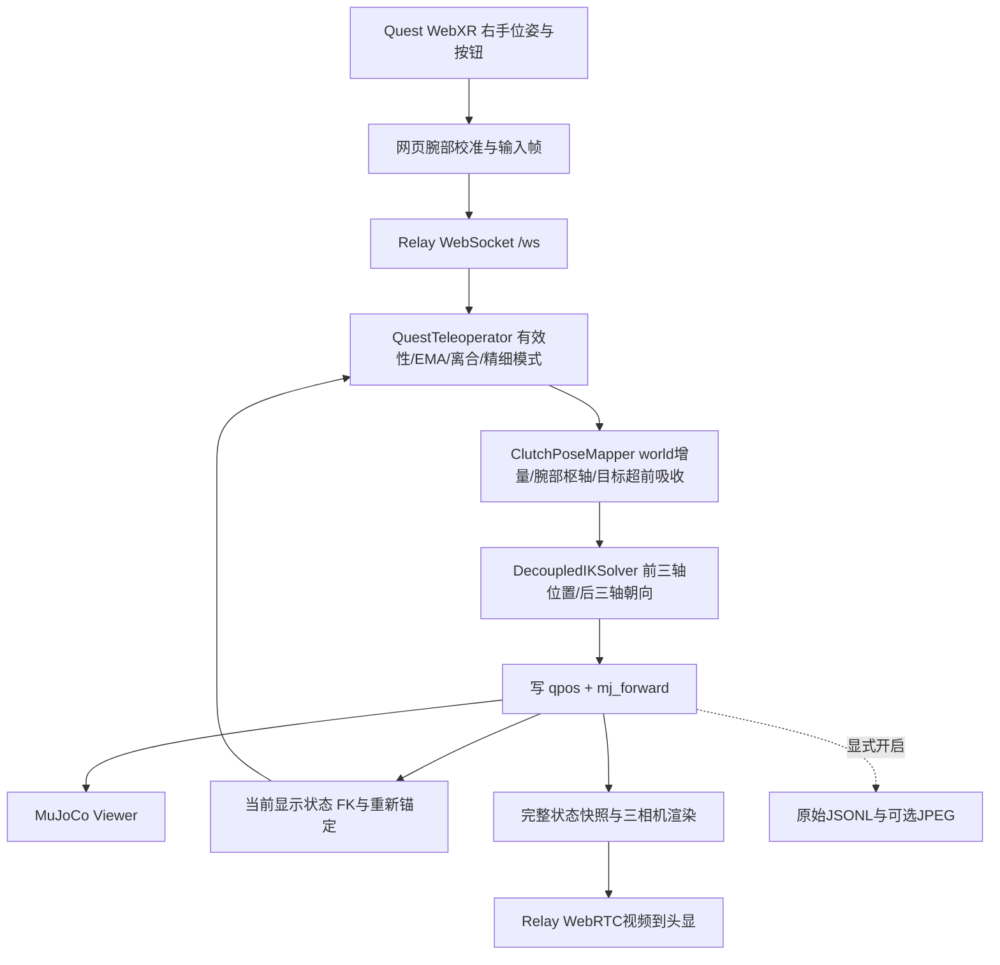

# 仿真遥操基线：sim-world-rg-2026-10-12

状态：初步固定。操作者已验收 `kinematic + world + RG` 的真实 Quest 手感，
并认可“夹爪摆正、相机在上方”的初始姿态。本基线作为后续真机后端开发对照。
tool_local 未获同等操作者验收；长时无线可靠性、真机和正式数据采集未验收。

## 启动入口

```bash
cd /home/lcw/VR_teleoperation
bash scripts/run_mujoco_teleop.sh --backend kinematic --rotation world --gripper rg
```

入口自带 Relay 和 MuJoCo Viewer，无需 ROS、RViz、MoveIt、单独 run_relay.sh 或 LeRobot。
默认环境为 `/data/VR_teleoperation_runtime/.venv/bin/python`，可用 TELEOP_PYTHON 显式覆盖。
先退出旧会话；工作区锁和端口检查拒绝冲突。头显地址为
`https://电脑当前局域网IP:8443/`，IP是运行环境，不是固定参数。
USB可加 `--usb`，并运行 `adb reverse tcp:8443 tcp:8443`，访问 `http://localhost:8443/`。
默认右手控制、桌面Viewer可见、三相机可用、Logger关闭。
网页 Camera streaming 默认关闭；开启视频不等于图像落盘。
校准、按钮和操作步骤见 [使用说明](mujoco_teleop.md)。

## 链路与代码职责



| 文件 | 职责 |
|---|---|
| `scripts/run_mujoco_teleop.sh` | 环境选择与启动 |
| `teleop/mujoco_session.py` | AUBO模型、RG_READY、运动学执行、Viewer、相机、可选Logger |
| `third_party/vr-teleop-kit/src/vr_teleop_kit/core/quest_teleop.py` | 作者控制循环与必要的单臂／输入／反馈处理 |
| 同目录 `core/pose_mapping.py` | 作者world枢轴目标管理；tool_local为额外比较项 |
| 同目录 `ik/decoupled_ik.py` | 作者FK、雅可比、解耦DLS公式，注入AUBO模型 |
| 同目录 `relay/server.py`、`relay/web/` | 网页、腕部拟合、Relay、WebRTC与输入传输 |
| `assets/aubo_i5/scene_ros2_rg_cameras.xml` 及其includes | AUBO/RG几何、三相机安装 |
| `ros2_ws/src/aubo_i5_teleop/scripts/gripper_profile.py` | 纯Python工具与夹爪参数；原生入口覆盖RG_READY |
| `ros2_ws/src/aubo_i5_teleop/config/robot_spec.yaml` | 带来源的关节范围和参考速度上界 |

读取ROS目录下的配置和纯Python文件，不代表依赖ROS节点。
显示状态等于应用的关节命令；这里的锚定反馈是虚拟显示状态，不是真机实测。

## 控制语义

| 项目 | 基线约定 |
|---|---|
| 后端／映射／夹爪 | kinematic／world／rg |
| 平移 | 固定Quest XR环境系映射到基座：前−Y、右−X、上+Z |
| 旋转 | 作者环境系增量转到基座，左乘目标朝向；不是工具局部轴对应 |
| 头显yaw | 关闭，不在重新接合时按头显朝向更改映射 |
| 右Grip | 当前显示FK捕获末端和腕部枢轴；松开保持关节位置 |
| 腕部语义 | 作者枢轴弧线，允许TCP走弧线，未强制大臂绝对静止 |
| 右Trigger | 模拟值>0.7按下沿切换OPEN/CLOSED，Grip松开仍有效 |
| 右A | 按住降低平移和旋转倍率 |
| 右摇杆按下 | 作者约2秒关节归位插值；不是避碰规划 |
| 缺失右手／输入超过0.2秒 | 暂停保持，恢复时重新锚定，不补跑旧目标 |
| XR空间／来源重置 | 要求松开再按Grip |
| 四元数 | WebXR xyzw转内部wxyz，不经欧拉角控制 |

头显仍提供追踪和XR会话。Grip接合时作者rest bias可引起微小修正，不保证严格零运动。

## 模型和参数

关节顺序：shoulder_joint、upperArm_joint、foreArm_joint、wrist1_joint、wrist2_joint、wrist3_joint。
原生入口唯一RG起始／归位配置为 `teleop/mujoco_session.py::RG_READY`：

```text
rad: [-1.137355, -0.4, 1.1707963267948966, 1.5707959803847207, 1.137355, 0.0]
deg: [-65.166, -22.918, 67.082, 90.000, 65.166, 0.000]（展示近似值）
```

编译模型ready key、归位目标与作者前三轴rest bias一致。上臂前倾、前臂水平、
夹爪摆正、腕部相机在上方。TCP基座位置约 `[0.11438,-0.78620,0.60029] m`，
位置变化已由操作者接受。腕3双向工作余量各约168.45°，没有另加±90°限制。
选定姿态的[预览图](baselines/sim-world-rg-2026-10-12.png)已随文档保存。
RG TCP为rg_base下 `(0,0,-0.1048) m`，工具wxyz四元数 `(0,1,0,0)`，+Z为接近轴。
j4_anchor为foreArm_Link上的joint-4原点，不照搬DK1额外10cm延伸。
相机安装、几何不改；RG开／合齿轮角 `−0.474409 / +0.463234 rad`，两指按现有MJCF联动显示。

| 启动默认参数 | 值 |
|---|---|
| 控制周期 | 200Hz，dt=0.005s |
| 平移／旋转倍率 | 1.5／1.5 |
| 精细模式倍率因子 | 0.5 |
| EMA alpha | 0.8 |
| 目标超前限制 | 0.25m／0.6rad，超出部分吸收 |
| 位置DLS | lam=0.05, lam0=0.15, w0=0.05, mu=0.02 |
| 朝向DLS | lam_rot=0.05, lam0_rot=0.4, w0_rot=0.5 |
| 朝向误差停腕门限 | 2.2rad |
| 六轴工作范围 | ±2.94rad |
| speed | 1.0，以前三轴150°/s、后三轴180°/s计算IK单步上界 |
| IK单步上界 | 前三轴约0.01309、后三轴约0.01571rad/tick |

上述算法参数为作者／项目配置，不是厂家伺服调优结果。单步上界针对IK更新，
不是作者归位插值的通用轨迹保证，也不代表真机速度已经核验。
网页可保存修改后的倍率与滤波，所以表中是**启动默认值**，不能推断已验收的每次
会话严格使用这些值。复现实验应保留网页参数和腕部校准Export；当前未保存操作者
实际浏览器设置快照；原始Logger记录部分有效参数（倍率／EMA等）与输入，
不能代替全部网页设置的完整快照。
相机目标30fps：D435 right/left为640×480，D405 wrist为1280×720。

## 记录与时钟

默认不创建数据目录；`--record`开启信号，另加`--record-images`才写JPEG。
2026-10-13补充：自动录制路径改为 `/data/VR_teleoperation_runtime/recordings/mujoco/<时间>`，
自定义新录制路径也要求位于 `/data`。该变更只调整存储，控制行为与本基线一致；没有迁移已有数据。
运动学标记state_source=kinematic_preview，显示角为q_simulated；q_measured、
物理速度与执行器力反馈为空。sim_time是预览周期时钟，不是物理积分时间。
PC monotonic与Quest t_client保留不同时间域，不伪造同步；排队年龄不是绝对单程延迟。
原始Logger不是LeRobot Dataset Builder。

## 验收与边界

- 操作者真实Quest验收world和当前姿态：“操作很舒服”。
- 最近26项回归通过，包含原作者200组world mapper、100组AUBO模型IK数值基准。
- 新起点world/tool_local双向90°拧转、归位一致性和采样接触检查通过；
  tool_local的自动检查不代表真实手感已经验收。
- 约10秒本机WS/WebRTC三路有效视频测试通过，先于最后归位调整；最后调整
  另有FK、方向、双向动作及操作者验收，不能推广为长时无线可靠性。
- 人工向上伸直姿态 `[0,0,0,-0.5,0.7,0]` 可向下回撤约6cm，剩余TCP位置误差约1.3cm。
  之前把水平需求失败解释成向内回撤失败的结论已纠正。

运动学不模拟抓取、重力下落或接触响应；没有在线避碰规划器，不保证任意路径安全。
不保证所有奇异姿态可退出或所有六维目标精确跟踪。控制柜／固件、实际位置伺服、
停止与实际反馈、工具校准、夹爪通信、真实相机和数据对齐需要独立接入验证。

## 作者复用与可选链

上游Dream-Machines-Robotics/vr-teleop-kit固定提交
`8d37f3d6bd44c8ce646f7bc110ac98e802e0ab57`，Apache-2.0。
默认流程对应作者pure_sim.py和viewer_client.py。必要差异为AUBO单右臂模型、工具／
枢轴、限位／步长、当前归位、HMD yaw关闭、独立二态夹爪、输入恢复和诊断增强。
逐文件差异见 [LOCAL_CHANGES.md](../third_party/vr-teleop-kit/LOCAL_CHANGES.md)。

| 内容 | 定位 |
|---|---|
| tool_local | 显式比较项，未作为当前基线 |
| AG95 | 可选夹爪，非当前默认 |
| physics | 实验对照；新增参考整形存在已复现暂态命令振荡 |
| 旧ROS Route B | 历史回退；authoritative_session.sh仍指向它 |
| Route A | 历史归档 |

后续真机接入优先增加执行／实际反馈后端，保留当前核心作对照。
修改默认姿态、映射、算法或参数时，更新基线并针对变化重新验收。
本次是文档与工作区指纹固定，不自动禁止修改，也不自动提交或推送Git。

## 工作区快照

[JSON快照](baselines/sim-world-rg-2026-10-12.json)保存本轮实际构造的启动默认参数、
模型状态与环境版本；[SHA-256清单](baselines/sim-world-rg-2026-10-12.sha256)记录运行源码、
模型资源和测试文件，不含证书、缓存或会话数据。base_git_head只是基础提交，工作区
包含未提交改动，以文件指纹说明本轮内容。该清单不是可恢复的完整Git归档。

```bash
cd /home/lcw/VR_teleoperation
sha256sum --check --quiet docs/baselines/sim-world-rg-2026-10-12.sha256
```

腕部校准、浏览器个人参数不在源码指纹内。
2026-10-13离线接入补充后，旧清单中的 README、teleop/mujoco_session.py和
tests/test_mujoco_teleop.py有已说明的变动（离线说明与录制路径/测试），旧清单保留为历史快照。
当前源码核验见 [本轮记录](aubo_offline_completion_2026-10-13.md)。
